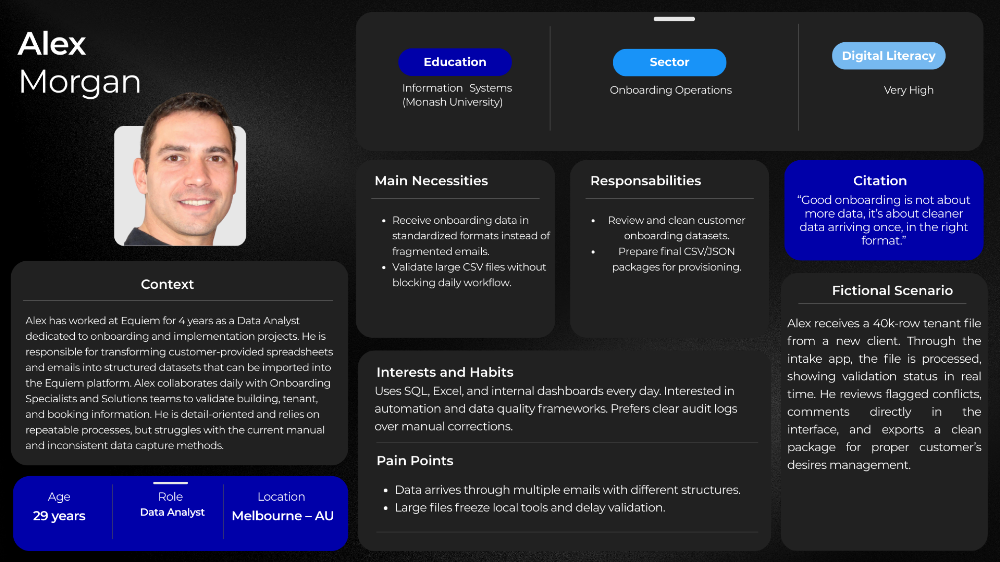
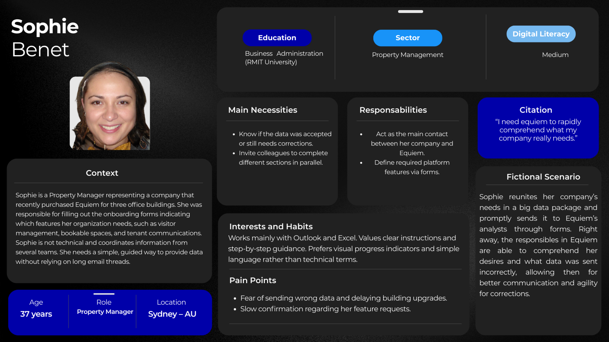
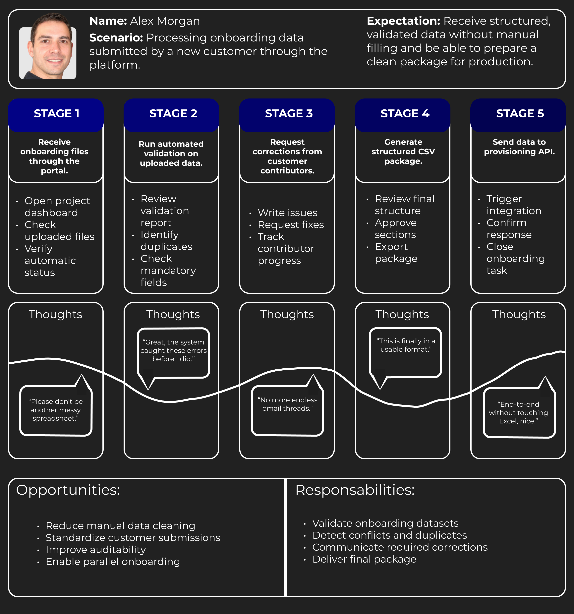
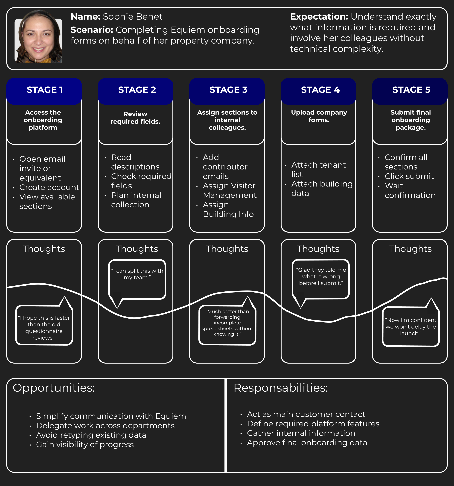
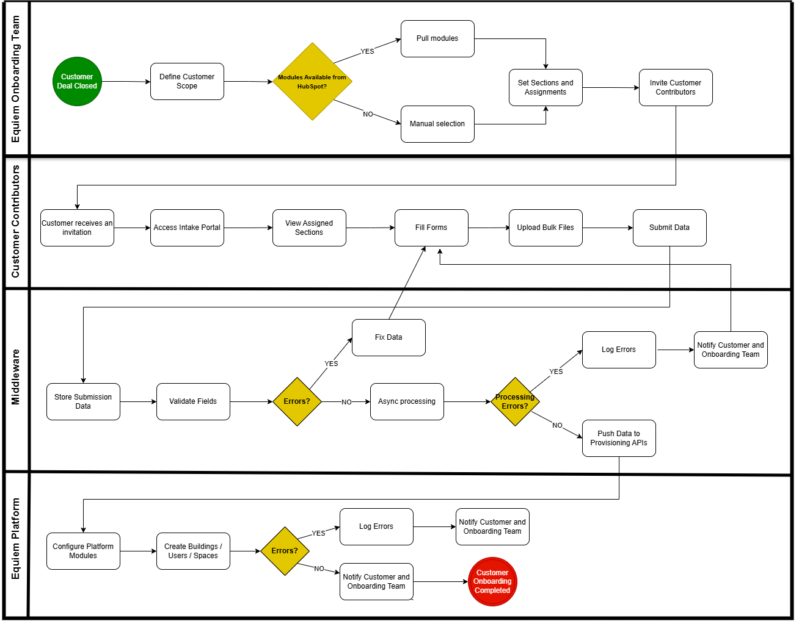
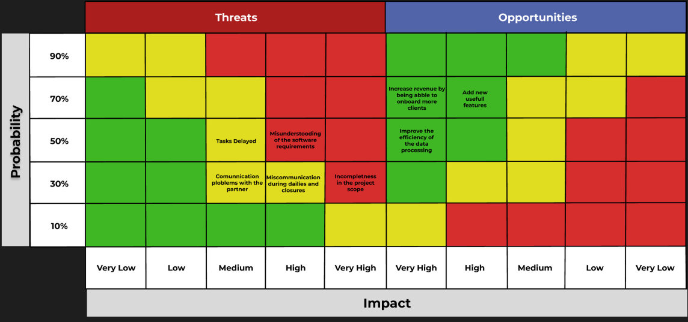

# Project and Business Understanding  
## ESMD5 - Digital Distributed Processing System  
### Partner: Equiem  

#### Team Members

---

## Table of Contents

[1. Problem Statement](#c1)  
[2. Partner Industry Context](#c2)  
[3. Product Vision](#c3)  
[4. Scope Definition](#c4)  
[5. Product Goal](#c5)  
[6. Personas and User Journey](#c6)  
[7. Business Flow](#c7)  
[8. Feature Brainstorming](#c8)  
[9. Delivery Sequencing and Prioritization](#c9)  
[10. MVP Canvas](#c10)  
[11. Project Risk Matrix](#c11)

---

## 1. Problem Statement

Equiem operates a SaaS platform that requires a significant amount of customer-specific data to be correctly configured before launch. This data includes information about buildings, spaces, users, permissions, branding, and operational rules, and is often provided by multiple stakeholders on the customer side. Currently, this onboarding data collection process is handled in a highly manual and fragmented way, primarily through emails and spreadsheets.

This approach is inefficient because data is received in inconsistent formats, with varying levels of completeness and quality, requiring extensive manual consolidation and validation by Equiem’s onboarding team. As the volume and complexity of data increase, so does the risk of human errors, duplicated work, misconfigurations, and delays in the onboarding timeline. These issues directly impact the time required to activate the platform for new customers.

The primary users affected by this problem are Equiem’s onboarding and customer experience teams, who spend a disproportionate amount of time on low-value, repetitive tasks such as data cleaning, clarification requests, and manual data transfer. On the customer side, project managers and administrators are also impacted, as they lack a clear, structured way to understand what information is required, track progress, or collaborate efficiently with other contributors during onboarding.

From a business perspective, this problem limits Equiem’s ability to scale onboarding operations in parallel, creating a bottleneck that affects growth, operational efficiency, and resource allocation. From a user perspective, the onboarding experience becomes slower, more error-prone, and less transparent, negatively influencing early perceptions of the platform’s value.

Addressing this problem is therefore critical to improving onboarding efficiency, reducing operational friction, and enabling Equiem to support growth without a proportional increase in manual effort, while also delivering a more reliable and predictable onboarding experience for customers.

---

## 2. Partner Industry Context

Equiem operates in the **Property Technology (PropTech)** sector, which focuses on applying digital solutions to the management and operation of real estate assets. This industry involves owners and operators of corporate, residential, and mixed-use buildings who manage complex and distributed portfolios composed of multiple spaces, services, and stakeholders. In this context, technology plays a strategic role by enabling process integration, data standardization, and efficient coordination of operations.

The PropTech market has evolved beyond operational efficiency, incorporating growing demands for user-centered experiences, greater flexibility in space utilization, and data-driven decision-making. Integrated SaaS platforms have become essential to connect building operations, space management, and occupant communication, increasing the reliance on structured and reliable data from the earliest stages of platform implementation.

Within this scenario, customer onboarding becomes a critical factor, as the correct configuration of these platforms depends on the collection of large volumes of heterogeneous data, which vary in format, structure, and quality and must be consolidated prior to system activation. When this process is handled manually through emails and spreadsheets, human errors, rework, and delays frequently occur, directly impacting time-to-launch and service quality.

For companies like Equiem, this represents a strategic opportunity to transform an operational bottleneck into a scalable digital process based on self-service, automation, and data validation, supporting sustainable growth and competitiveness in the PropTech market.

---

## 3. Product Vision

The product aims to transform Equiem’s onboarding process by replacing manual and fragmented data collection with a structured, self-service, and asynchronous platform. 

By centralizing data intake, automating validation, and providing clear feedback throughout the onboarding journey, the solution seeks to improve data quality, reduce operational effort, and create a more transparent and predictable experience for both Equiem’s internal teams and customers.

Lastly, the platform supports Equiem’s scalability by enabling multiple onboarding processes to run in parallel without a proportional increase in manual workload.

---

## 4. Scope Definition

### 4.1 What the Product Does

- The product provides authenticated access for each user involved in the onboarding process, ensuring that data submissions and reviews are associated with identifiable actors.

- It organizes submitted onboarding data into structured classes, allowing information to be clearly displayed, reviewed, and exported in a consistent and standardized format.

- The platform is designed to handle large files and datasets, supporting high-volume uploads without blocking user interaction.

- Asynchronous processing is a core capability of the system, enabling data validation and preparation to occur in the background while users receive immediate feedback on submission status.

- The system also supports the handling of multiple onboarding requests simultaneously, allowing parallel processing and improving operational scalability.

---

### 4.2 What the Product Does Not Do

- The product does not generate new business data or infer information beyond what is explicitly provided by users during onboarding.

- It does not include data visualization features such as charts, or analytical graphs, focusing instead on data structuring and preparation.

- The platform does not perform real-time provisioning or configuration of Equiem’s production systems, operating only as a preprocessing and validation layer.

- It also does not offer advanced business intelligence, reporting capabilities, or decision-support tools beyond basic data exports.

---

## 5. Product Goal

The product’s goal is to make Equiem’s customer onboarding process easier to scale by moving away from manual, email-based data collection toward a structured and automated approach. It’ll allow customers to provide all required onboarding informations through a guided and validated flow, ensuring the data is complete, good, and ready to be used.
By automating data collection and validation, it will significantly reduce the operational workload of Equiem’s onboarding teams, minimize back-and-forth communication (via email), and shorten the time required to launch new customers on the platform. At the same time, it'll enable multiple onboarding projects to be managed in parallel.
Overall, the product supports Equiem’s growth by improving onboarding efficiency, offering customers a clearer and more intuitive setup experience, and freeing internal teams from manual data handling so they can focus on more valuable tasks.

---

## 6. Personas and User Journey

### 6.1 Personas

The following personas were developed to represent the stakeholders involved in the Equiem onboarding ecosystem. Their relevance as instruments for scope definition and requirements engineering is supported by the study “Who Uses Personas in Requirements Engineering: The Practitioners' Perspective (2024)”, which highlights how realistic user representations improve alignment between technical and real operational needs.

These personas translate the complexity of the onboarding process into two complementary perspectives:

- the internal operational view, represented by the Equiem Data Analyst responsible for validating and structuring customer data;

- and the external customer view, represented by a client Project Manager who must provide information through the platform.

Understanding their contexts allows the solution to be designed around clearer expectations of efficiency, usability, and reliability, rather than purely technical assumptions:

FIGURE 1 – Persona 1 - Alex Morgan (Data Analyst – Equiem) 
  
  Source: Material produced by the authors, 2026.

FIGURE 2 – Persona 2 - Sophie Bennett (Client's Project Manager) 
  
  Source: Material produced by the authors, 2026.

Alex Morgan (Data Analyst – Equiem) and Sophie Bennett (Client's Project Manager) represent the two sides of the onboarding workflow. Alex operates inside Equiem, focused on data quality, validation, and preparation for production. His main concerns are structure, automation, and auditability. Sophie, on the other hand, acts as the bridge between her organization and Equiem, seeking clarity, simplicity, and guidance while coordinating multiple internal contributors.

Their complementary needs reinforce the project's objective: a platform capable of reducing conflicts for customers while increasing scalability and agility for Equiem.

### 6.2 User Journey

The user journeys below illustrate the interaction flows that each persona will experience when using the onboarding system. They were designed to map actions, thoughts, and emotions across the main stages of the process from initial data submission to final provisioning.

By analyzing these journeys, it becomes possible to identify pain points, opportunities for automation, and moments where the platform delivers clear value to both Equiem and its customers:

FIGURE 3 – User Journey 1 - Alex Morgan (Data Analyst – Equiem) 
  
  Source: Material produced by the authors, 2026.

Alex’s journey centers on data and operational efficiency.
He begins receiving files through the portal and trusting the pipeline to handle large uploads without blocking his workflow.

The emotional peak occurs during the validation stage, when the system automatically detects duplicates and format issues that would previously require hours of manual Excel work. This represents the main value creation moment of the platform.

The journey ends positively with the generation of a clean CSV package after receiving the corrected informations from the client, giving Alex confidence in the coherence of the data.

FIGURE 4 – User Journey 2 - Sophie Bennett (Client's Project Manager) 
  
  Source: Material produced by the authors, 2026.

Sophie’s journey reflects the perspective of a non-technical customer responsible for coordination.
She starts with uncertainty, hoping the new platform will bring a faster exchange than previous long questionnaires. 

Then Sophie assigns correction sections to colleagues, which transforms onboarding from an individual activity into a collaborative task. Anxiety reappears during data upload, but immediate feedback reassures her before submission.

The journey concludes with confidence, as she submits the final package knowing that Equiem received structured and correct information given the platforms and analysts validation.
 
 
Alex and Sophie’s journeys represent the entirety of the Equiem onboarding process, from customer data entry to internal revision. Their interaction validates the needs for a distributed architecture and a collaborative space.

By addressing their distinct but connected expectations, the project establishes a user-centered approach capable of improving data integrity, insertion and customer experience.

---

## 7. Business Flow

This business flow illustrates the target process enabled by our proposed solution. It introduces a middleware component into the onboarding journey, positioned between customer data submission and platform provisioning. Its role is to centralize data intake, standardize validations, and structure information before it reaches internal systems, creating a more organized, scalable, and efficient onboarding experience.

FIGURE X – Business Flow 
  
  Source: Material produced by the authors, 2026.

With the addition of the middleware layer, the onboarding process becomes more resilient, faster, and easier to manage. Automated validations, asynchronous processing, and structured data packaging reduce manual effort while improving data quality and operational efficiency for both customers and internal teams.

## 8. Feature Brainstorming

### Product Goal 1: Make onboarding easier and more scalable

**MVP Features**
- Secure user authentication to access the onboarding process
- File upload functionality for onboarding documents
- Support for very large data and file uploads
- Ability to manage multiple onboarding processes in parallel

**Nice-to-Have Features**
- Progress indicator to visualize onboarding completion status

---

### Product Goal 2: Improve data management and data quality

**MVP Features**
- Real-time validation of submitted data
- Detection and warning for missing mandatory fields
- Alerts for duplicated data entries
- Clear error messages for invalid or inconsistent data
- Collaborative work on onboarding data between multiple users

**Nice-to-Have Features**
- Version history to track data changes during onboarding

---

### Product Goal 3: Improve the user experience through an intuitive interface

**MVP Features**
- Clear and intuitive user interface for data submission
- Ability for users to view uploaded files before final submission
- Save user progress to allow onboarding to be completed over multiple sessions
- Standardized file templates provided to clients

**Nice-to-Have Features**
- Dark mode for improved visual comfort
- Contextual help or tooltips during onboarding steps

---

## 9. Delivery Sequencing and Prioritization

Considering that Sprint 1 is dedicated to business analysis and problem understanding, feature delivery begins in Sprint 2. The sequencing of deliveries was defined based on clear prioritization criteria aligned with the MVP objective. The main prioritization criteria adopted were:

- Impact on the core problem
- Technical dependencies
- Data integrity and operational reliability
- Operational scalability
- Processing and architectural complexity

**Sprint 2 — Core onboarding foundation**

Users can securely access the platform and follow a guided onboarding flow. The interface is already structured so customers know what to submit, and templates help standardize data.

Delivered in this sprint:

- Secure authentication;
- Clear submission interface;
- Standardized templates.

**Sprint 3 — Submission and data reliability**

Users can upload files, preview them, and save progress. At the same time, validation ensures the data is complete and correct before submission.

Delivered in this sprint

- File uploads
- File preview before submission
- Save progress across sessions
- Real time validation
- Mandatory field checks
- Duplicate detection
- Clear error messages

**Sprint 4 — Parallel work and collaboration**

Multiple onboarding processes can run at the same time, and multiple stakeholders can collaborate inside each onboarding.

Delivered in this sprint

- Parallel onboarding processes
- Collaborative onboarding completion

**Sprint 5 — Large scale processing**

The final MVP sprint focuses on technical scalability, the system becomes able to handle very large uploads and process them asynchronously without blocking the interface.

Delivered in this sprint

- Support for very large uploads
- Scalable file processing

After completing the must-have features, if time allows, the team may start implementing nice-to-have enhancements such as role-based access, progress indicators, version history, tooltips, and dark mode.

## 10. MVP Canvas

_Present the MVP Canvas, including:_

- _Value proposition_  
- _Customer segments_  
- _Key activities_  
- _Success metrics_

---

## 11. Project Risk Matrix
A Risk Matrix is a fundamental tool used in project management and data governance to identify, assess, and prioritize potential threats to a project. It classifies these threats in a grid based on two dimensions: Likelihood and Impact.

FIGURE X – Risk Matrix 
  
  Source: Material produced by the authors, 2026.

| Threats | Description | Impact | Probability | Contigency Action |
| ------- | ----------- | ------ | ----------- | ----------------- |
| Delayed Tasks | Tasks may exceed their planned deadlines due to technical complications or underestimation of the workload. | Medium | 50% | Further complications with a task must be reported   to the group; the workload will then be redistributed among team members. |
| Misunderstooding of the software requirements | The group may misinterpret project requirements, leading to a solution that fails to meet the partner's expectations. | High | 50% | Requirements must be cross-checked during validation sessions with the partner to ensure alignment. |
| Comunnication ploblems with the partner | Poor communication due to linguistic differences or delays in feedback from the partner may lead to a misalignment between the group and Equiem technical expectations. | Medium | 30% | Use of transcription tools, such as Granola during meetings to bridge potential linguistic gaps. |
| Miscommunication during dailies and closures | Miscommunication during daily meetings or closures may lead to a lack of alignment regarding task dependencies and progress. | High | 30% | Every team member must participate in all daily meetings and closures; additionally, the Scrum Master will provide daily reports in the Slack channel to ensure alignment. |
| Incompletness in the project scope  | The team may fail to deliver core MVP features, such as the module-driven dynamic forms or the asynchronous processing pipeline, due to underestimating the complexity of the requirements. | Very High | 30% | Conduct a formal validation session of the Lean Inception with the partner to confirm the MVP scope. |

Opportunities represent 'positive risks' that can be used to enhance project value. The risk matrix allows us to identify opportunities, allowing the team to look beyond problem-solving and focus on strategic growth and operational excellence.

| Opportunities | Impact | Probability | 
| ------- | ------ | ----------- | 
| Increase revenue by being abble to onboard more clients | Very High | 70% | 
| Add new usefull features | High | 70% | 
| Improve the efficiency of the data processing | Very High | 50% | 