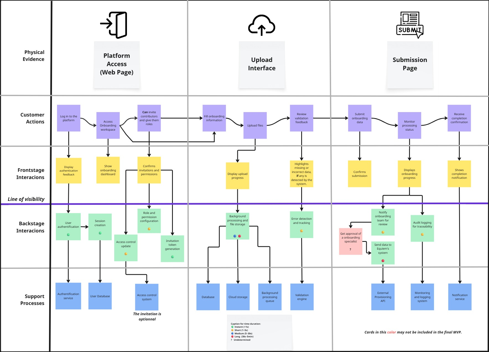

# Service Blueprint – Equiem Onboarding Data Intake

The objective of this Service Blueprint is to map the full lifecycle of the Equiem onboarding data intake process, identifying the relationship between user actions, visible system behavior, internal backend processes, and supporting infrastructure.

Following the IxDF framework, the blueprint is structured using five swim lanes.

## 1. The Components

### Physical/Digital Evidence 
**What the user interacts with :** 

- Platform Acess (Web Page)
- Upload Interface
- Submission Page

---

### Customer Actions  
**What the user is doing :**

- Log in to the platform  
- Access onboarding workspace
- Can invite contributors and give them roles
- Fill onboarding information 
- Upload files  
- Review validation feedback  
- Submit onboarding data  
- Monitor processing status 
- Receive completion confirmation

These actions are organized from left to right in the blueprint to reflect the user journey.

---

### Frontstage (Visible Software Behavior)  
**What the system shows :**

- Display authentication feedback 
- Show onboarding dashboard
- Confirms invitations and permissions
- Display upload progress
- Highlights missing or incorrect data, if any is detected by the system.
- Confirms submission 
- Shows completion notification

---

### Backstage (Internal Processes)  
**What happens behind the scenes :**

- User authentication 
- Session creation
- Acess control update
- Role and perimission configuration
- Invitation token generation
- Background processing and file storage
- Error detection and tracking
- Notify onboarding team for review 
- Get approval of a onboarding specialist
- Sent data to Equiem's system
- Auddit logging for traceability

These processes occur below the Line of Visibility and are not directly observable by the user.

---

### Support Processes  
**Services used by backstage processes :**

- Authentification service
- User Database
- Acess control system
- Database
- Cloud Storage 
- Acess control system
- Background processing queue
- Validation Engine  
- External provisioning API
- Monitoring and logging system
- Notification Service  

## 2. The Service Blueprint Structure: 

For this blueprint, the team selected the primary use case:

A client uploads multiple CSV files containing building information and submits them through the onboarding middleware for validation and integration into Equiem’s system.

### The Customer:

The main persona represented in this blueprint is **Chloe Smith**, an Equiem client responsible for submitting structured building data during the onboarding process.

----

The complete Service Blueprint diagram is presented below:

FIGURE 1 - Service Blueprint 
   
  Source: Material produced by the authors, 2026.

For an interactive version of the diagram, the blueprint is also available on Miro via this [link](put link).

--- 

## 3. Technical Enhancements

To strengthen the blueprint from a Software Engineering perspective, time estimations and bottleneck analysis were incorporated.

Backstage processes include estimated duration tags:

- 🟢 Instant (<1s) 
- 🟡 Short (1–5s) 
- 🔵 Medium (5–30s)
- 🔴 Long (30s–5min)
- Undetermined 

Including time estimations allows the team to evaluate how backend latency may impact the frontstage user experience and identify potential performance risks.

## 4. Bottlenecks and Fail Points

Three main potential bottlenecks were identified:

### 4.1. Large File Validation

Processing large CSV files may significantly increase validation time, especially during asynchronous background execution. This may delay status updates and completion confirmation.

### 4.2. Manual Approval Delay

The approval performed by an onboarding specialist introduces a human-dependent delay. Since the review time cannot be precisely estimated, it is classified as undetermined and represents a potential bottleneck.

### 4.3. External API Integration

Sending validated data to Equiem’s external system depends on successful integration. Failures in this step may result in submission delays or error states.

To mitigate the identified bottlenecks, the team plans to prioritize the development of a robust and scalable backstage architecture. Special focus will be placed on optimizing asynchronous processing to ensure that large file validation and background tasks execute as efficiently as possible, minimizing perceived delays in the frontstage experience.

Additionally, the necessity of the manual approval step will be validated in collaboration with the partner. If business rules allow, reducing or eliminating this human-dependent stage could significantly decrease overall processing time and improve system responsiveness.

Regarding external API integration, careful implementation, testing, and monitoring will be required to ensure reliability.

---

This Service Blueprint provides a structured and user-centered visualization of the Equiem onboarding data intake process. By clearly mapping customer actions, visible system behavior, internal processes, and supporting infrastructure, the blueprint enables a deeper understanding of the service ecosystem.