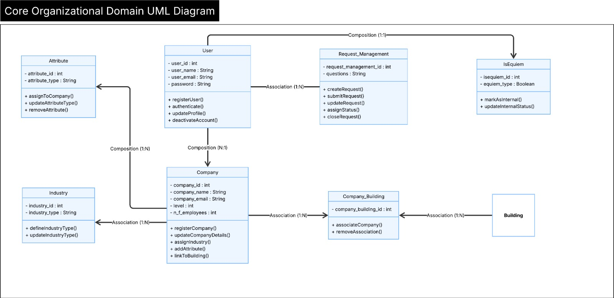
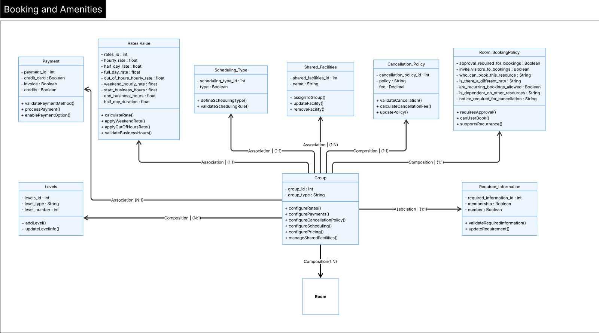
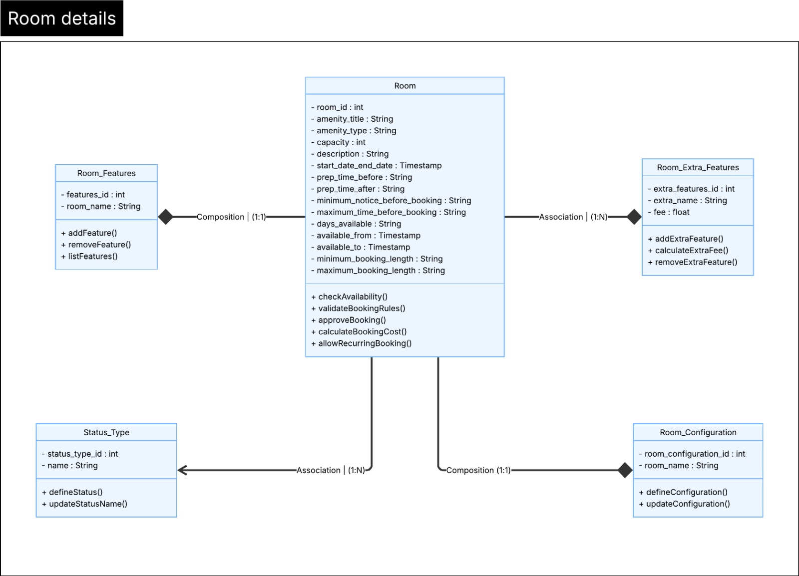
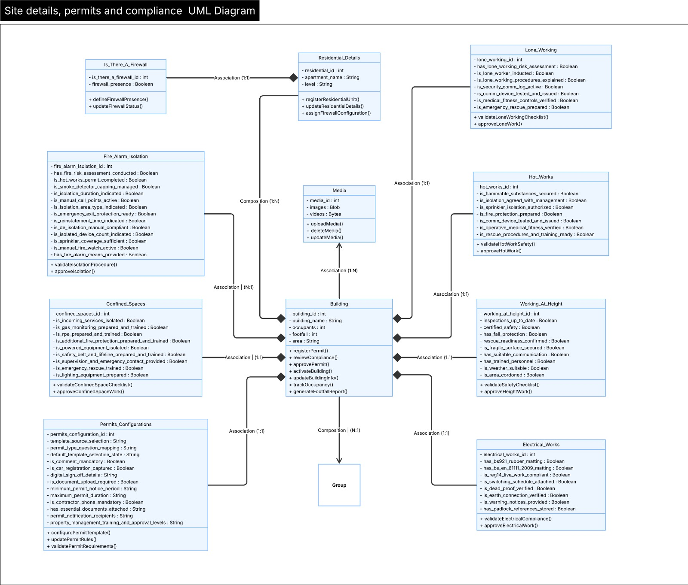
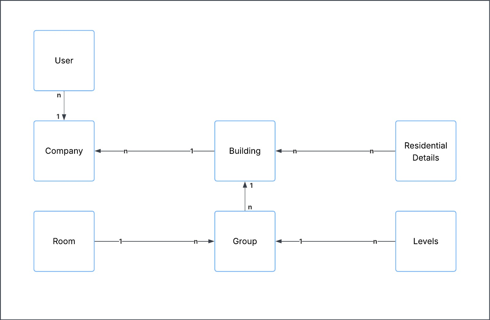

# Domain UML Class Diagram

## Table of Contents
1. [Overview](#1-overview)  
2. [Domain Class Diagram](#2-domain-class-diagram)  
3. [Domain Classes](#3-domain-classes)  
4. [Relationships and Multiplicities](#4-relationships-and-multiplicities)  
5. [Modeling Decisions](#section-5--key-modeling-decisions)  
6. [Conclusion](#6-conclusion)

---

# 1. Overview

This document presents the **Domain UML Class Diagram** for the project.

The objective of this artifact is to model the **conceptual classes** that exist in the problem domain, representing real-world entities and their relationships, rather than software implementation details.

This diagram:

- Identifies the main domain classes
- Defines their relevant attributes
- Establishes relationships with correct multiplicities
- Applies association, aggregation, and composition where appropriate

The model is purely conceptual and independent of programming language or database implementation.

---

# 2. Domain Class Diagram

This section presents the Domain UML Class Diagrams derived from the conceptual model. To ensure clarity and modularity, the system is divided into four domain-specific diagrams, plus one integration diagram that summarizes their structural connections. The diagrams focus on class structure and relationships. Detailed modeling decisions, multiplicities, and abstractions are addressed in later sections.

---

## 2.1 Core Organizational Domain

This diagram represents the foundational structure of organizations, users, and buildings. It defines how companies and users are positioned within buildings and establishes the structural backbone that supports all other domains.

FIGURE 1 – Core Organization Domain 
  
  Source: Material produced by the authors, 2026.

---

## 2.2 Booking and Amenities Domain

This diagram models the booking ecosystem, including rooms, configurations, pricing rules, payment settings, scheduling logic, and facilities. Group functions as the governance layer for booking logic within each building subdivision. The objective is to isolate booking structures without introducing organizational or compliance complexity.

FIGURE 2 – Booking and Amenities 
  
  Source: Material produced by the authors, 2026.

---

## 2.3 Room Domain

The **Room** entity represents a reservable resource within a building. Structurally, the Room entity maintains composition relationships with Room_Configuration and Room_Features, associates with Room_Extra_Features to support optional pricing extensions, and connects to Status_Type for booking state classification.

FIGURE 3 – Room Details 
  
  Source: Material produced by the authors, 2026.

---

## 2.4 Permits and Compliance Domain

This diagram models regulatory and safety control entities associated with buildings. It includes permit configuration and distinct compliance categories required for controlled operational activities, so all compliance structures are scoped at the building level.

FIGURE 4 – Site Details, permits and compliance 
  
  Source: Material produced by the authors, 2026.

---

## 2.5 Domain Integration Diagram

This diagram provides a simplified structural overview of how the four domains connect. The integration view reinforces modular separation while demonstrating overall system cohesion.

FIGURE 5 – Cross relations 
  
  Source: Material produced by the authors, 2026.

---

# 3. Domain Classes

This section defines the conceptual classes identified in the problem domain, extracted from the spreadsheets provided by the company as part of the onboarding process for new clients. These entities represent the core business data that must be structured and persisted to support property management, booking operations, request workflows, residential configurations, media management, and permit control. For each class, only essential attributes and the primary key are specified, establishing a clear and consistent foundation for the subsequent logical data model.

## Core Organizational Domain

This section defines the core structural entities that represent organizations, users, buildings, and their primary relationships within the system.

| Class Name | Description | Attributes |
|------------|------------|------------|
| Company | Represents an organization (contractor) operating within one or more buildings managed by the platform. | company_id (PK), name, registration_number, industry_id |
| Industry | Defines the industry classification associated with a company. | industry_id (PK), name |
| Attribute | Represents descriptive characteristics associated with a company. | attribute_id (PK), company_id, name, value |
| User | Represents a platform user, such as a tenant, administrator, or property manager. | user_id (PK), name, email, company_id |
| IsEquiem | Identifies whether a user belongs to the internal Equiem team. | is_equiem_id (PK), user_id, is_internal |
| Building | Represents the primary operational entity where tenants operate and services are configured, it stands for the site where the buildings are located. | building_id (PK), name, address, status |
| Company_Building | Represents the association between companies and buildings(site), allowing one company to operate in multiple buildings. | company_building_id (PK), company_id, building_id |
| Levels | Represents the floors within a building. | level_id (PK), building_id, level_number |
| Group | The building unit within a building(site) used to organize pricing structures, payment options, and facilities. | group_id (PK), building_id, name |
| Media | Represents multimedia assets linked to buildings or other related entities. | media_id (PK), building_id, file_url, media_type |

## Booking and Amenities Domain

This section models bookable spaces, scheduling logic, pricing structures, and associated facilities.

| Class Name | Description | Attributes |
|------------|------------|------------|
| Scheduling_type | Defines the scheduling logic applied to bookings (e.g., flexible or slot-based). | scheduling_type_id (PK), name, description |
| Rates value | Represents pricing rules applied to bookable resources. | rate_id (PK), group_id, scheduling_type_id, price |
| Payment | Defines the payment options available for bookings. | payment_id (PK), group_id, payment_type |
| Cancellation policy | Defines cancellation rules and any associated penalties or fees. | cancellation_policy_id (PK), group_id, cancellation_window, penalty |
| Shared Facilities | Represents shared amenities available within buildings. | facility_id (PK), building_id, name |
| Room | Represents spaces available for booking within a building. | room_id (PK), building_id, level_id, group_id, name, capacity |
| Room configuration | Defines layout variations available for a room (e.g., theatre, U-shaped). | room_configuration_id (PK), room_id, configuration_type |
| Room features | Represents standard features included in a room. | room_feature_id (PK), room_id, feature_name |
| Room extra features | Represents optional add-on features that may incur additional cost. | room_extra_feature_id (PK), room_id, feature_name |
| Required_information | Defines mandatory information required during the room booking process. | required_information_id (PK), group_id, field_name, is_required |

## 3 — Request Management Domain

This section defines entities responsible for service request handling and workflow management.

| Class Name | Description | Attributes |
|------------|------------|------------|
| Request_Management | Represents help desk or service request configuration and tracking. | request_id (PK), building_id, user_id, status_type_id, created_at |
| Status_Type | Defines operational or workflow status classifications. | status_type_id (PK), name |
| Configuration | Represents configuration settings linking companies and buildings within operational workflows. | configuration_id (PK), company_id, building_id, setting_name |

## 4 — Residential Domain

This section captures residential unit details and associated security configurations.

| Class Name | Description | Attributes |
|------------|------------|------------|
| Residential Details | Represents residential unit details associated with a building. | residential_id (PK), building_id, residential_type |
| Is_There_A_Firewall | Indicates the presence of firewall or security infrastructure within a residential context. | firewall_id (PK), residential_id, is_present |

## 5 — Permits and Compliance Domain

This section models safety compliance and permit-related records required for regulated operational activities.

| Class Name | Description | Attributes |
|------------|------------|------------|
| Permits_Configurations | Defines configuration settings established by Equiem’s team for contractor onboarding workflows. | permit_config_id (PK), building_id, permit_type, approval_required |
| Working at Height | Represents safety compliance records for height-related work activities. | working_height_id (PK), building_id, safety_plan_required |
| Eletrical Works | Represents compliance and permit records for electrical activities. | electrical_work_id (PK), building_id, voltage_level |
| Fire Alarm Isolation | Represents compliance records for fire alarm isolation procedures. | fire_alarm_id (PK), building_id, isolation_duration |
| Hot Works | Represents permit records for high-risk heat-based operational activities. | hot_work_id (PK), building_id, fire_watch_required |
| Lone Working | Represents compliance records for individuals performing work alone. | lone_work_id (PK), building_id, supervision_required |
| Confined_Spaces | Represents compliance records for operations conducted within confined spaces. | confined_space_id (PK), building_id, ventilation_required |

---
# 4. Relationships and Multiplicities

This section defines the relationships between the conceptual classes using UML relationship types (Association, Aggregation, and Composition), along with their respective multiplicity constraints and concise real-world interpretations. Each relationship specifies how entities interact within the domain, clarifying structural dependencies, participation requirements, and business rules that govern organizational structure, operational workflows, booking logic, compliance control, and building-level configurations. 

---
## Building – Group

Type: Composition

Multiplicity:
Building → Group: (1..*)
Group → Building: (1..1)

Description:
A building is composed of one or more groups used to organize pricing structures, facilities, and booking logic. Groups depend on the building for existence.

---

## Building – Lone_Working

Type: Association

Multiplicity:
Building → Lone_Working: (1..1)
Lone_Working → Building: (1..1)

Description:
Each building maintains a single lone working compliance configuration record, and that record exists exclusively within the context of one building.

---

## Building – Permits_Configurations

Type: Association

Multiplicity:
Building → Permits_Configurations: (1..1)
Permits_Configurations → Building: (1..1)

Description:
Permit configuration rules are defined at the building level and are uniquely associated with that building.

---

## Building – Hot_Works

Type: Association

Multiplicity:
Building → Hot_Works: (1..1)
Hot_Works → Building: (1..1)

Description:
Each building maintains one hot works compliance configuration governing high-risk heat-based activities.

---

## Building – Confined_Spaces

Type: Association

Multiplicity:
Building → Confined_Spaces: (1..1)
Confined_Spaces → Building: (1..1)

Description:
Each building has a single confined spaces compliance configuration linked exclusively to it.

---

## Building – Working_At_Height

Type: Association

Multiplicity:
Building → Working_At_Height: (1..1)
Working_At_Height → Building: (1..1)

Description:
Working-at-height compliance rules are defined per building and are uniquely associated with that building.

---

## Building – Fire_Alarm_Isolation

Type: Association

Multiplicity:
Building → Fire_Alarm_Isolation: (1..*)
Fire_Alarm_Isolation → Building: (1..1)

Description:
A building may register multiple fire alarm isolation records, each tied to a single building context.

---

## Building – Electrical_Works

Type: Association

Multiplicity:
Building → Electrical_Works: (1..1)
Electrical_Works → Building: (1..1)

Description:
Each building maintains one electrical works compliance configuration.

---

## Building – Media

Type: Association

Multiplicity:
Building → Media: (0..*)
Media → Building: (1..1)

Description:
A building may be associated with multiple multimedia assets, each asset belonging to one building.

---

## Building – Residential_Details

Type: Composition

Multiplicity:
Building → Residential_Details: (0..*)
Residential_Details → Building: (1..1)

Description:
Residential units are structurally contained within a building and cannot exist independently of it.

---

## Residential_Details – Is_There_A_Firewall

Type: Association

Multiplicity:
Residential_Details → Is_There_A_Firewall: (1..1)
Is_There_A_Firewall → Residential_Details: (1..1)

Description:
Each residential unit has one associated firewall/security indicator record.

---

## Building – Company_Building

Type: Association

Multiplicity:
Building → Company_Building: (1..*)
Company_Building → Building: (1..1)

Description:
A building may be linked to multiple company-building association records.

---

## Company – Company_Building

Type: Association

Multiplicity:
Company → Company_Building: (1..*)
Company_Building → Company: (1..1)

Description:
A company may operate in multiple buildings through company-building association records.

---

## Company – Industry

Type: Association

Multiplicity:
Company → Industry: (1..1)
Industry → Company: (0..*)

Description:
Each company belongs to one industry classification, while an industry may classify multiple companies.

---

## Company – Attribute

Type: Composition

Multiplicity:
Company → Attribute: (0..*)
Attribute → Company: (1..1)

Description:
A company is composed of multiple descriptive attributes that cannot exist independently of it.

---

## User – IsEquiem

Type: Composition

Multiplicity:
User → IsEquiem: (1..1)
IsEquiem → User: (1..1)

Description:
Each user has exactly one internal identification status indicating whether they belong to the Equiem team.

---

## User – Company

Type: Composition

Multiplicity:
User → Company: (1..1)
Company → User: (0..*)

Description:
Each user belongs to one company, while a company may have multiple users associated with it.

---

## Request_Management – User

Type: Association

Multiplicity:
Request_Management → User: (1..*)
User → Request_Management: (0..*)

Description:
Service requests may involve one or more users, and a user may be associated with multiple requests.

---

## Room – Room_Configuration

Type: Composition

Multiplicity:
Room → Room_Configuration: (1..1)
Room_Configuration → Room: (1..1)

Description:
Each room has exactly one primary configuration definition.

---

## Room – Room_Features

Type: Composition

Multiplicity:
Room → Room_Features: (0..*)
Room_Features → Room: (1..1)

Description:
A room may include multiple standard features that are structurally part of the room.

---

## Room – Status_Type

Type: Association

Multiplicity:
Room → Status_Type: (1..1)
Status_Type → Room: (0..*)

Description:
Each room is associated with one operational status classification, while a status type may apply to multiple rooms.

---

## Room – Room_Extra_Features

Type: Association

Multiplicity:
Room → Room_Extra_Features: (0..*)
Room_Extra_Features → Room: (1..1)

Description:
A room may offer multiple optional add-on features, each linked to a specific room.

---

## Group – Room

Type: Composition

Multiplicity:
Group → Room: (0..*)
Room → Group: (1..1)

Description:
A group contains multiple rooms within the same pricing and booking structure.

---

## Group – Payment

Type: Association

Multiplicity:
Group → Payment: (1..1)
Payment → Group: (0..*)

Description:
Each group defines one payment configuration, while a payment method may be reused across multiple groups.

---

## Group – Shared_Facilities

Type: Association

Multiplicity:
Group → Shared_Facilities: (0..*)
Shared_Facilities → Group: (1..1)

Description:
A group may provide access to multiple shared facilities.

---

## Group – Scheduling_Type

Type: Association

Multiplicity:
Group → Scheduling_Type: (1..1)
Scheduling_Type → Group: (0..*)

Description:
Each group operates under one scheduling logic, which may be reused across different groups.

---

## Group – Levels

Type: Composition

Multiplicity:
Group → Levels: (1..1)
Levels → Group: (0..*)

Description:
Each group is associated with one building level, while a level may contain multiple groups.

---

## Group – Rates Value

Type: Association

Multiplicity:
Group → Rates Value: (1..1)
Rates Value → Group: (0..*)

Description:
Each group has one pricing structure, which may be applied across multiple groups if required.

---

## Group – Required_Information

Type: Association

Multiplicity:
Group → Required_Information: (1..1)
Required_Information → Group: (0..*)

Description:
Each group defines one set of mandatory booking information requirements.

---

## Group – Room_BookingPolicy

Type: Composition

Multiplicity:
Group → Room_BookingPolicy: (1..1)
Room_BookingPolicy → Group: (1..1)

Description:
Each group includes one booking policy configuration that is structurally dependent on it.

---

## Group – Cancellation_Policy

Type: Composition

Multiplicity:
Group → Cancellation_Policy: (1..1)
Cancellation_Policy → Group: (1..1)

Description:
Each group defines one cancellation policy that depends on the group for existence.

---

# Section 5 — Key Modeling Decisions

This section presents the main modeling decisions adopted during the construction of the Domain UML Class Diagram. The objective is to clarify the rationale behind structural choices, abstraction level, relationship types, and multiplicities.

---

## Inclusion of Domain Classes

The domain classes were selected based on structural relevance, operational responsibility, and regulatory significance identified in the onboarding documentation and organizational data sources.

The model is anchored around Building as the primary operational entity of the system. Building acts as the structural nucleus that connects organizational entities (Company, User), operational entities (Group, Room), and compliance entities (Permits and Safety classes). Its central positioning reflects its real-world role as the physical and administrative context in which all activities occur.

Company and User were included as core organizational actors responsible for interacting with the platform. Company_Building was explicitly modeled to formalize the many-to-many operational relationship between companies and buildings, avoiding implicit assumptions and preserving conceptual clarity.

Group was introduced as an intermediate organizational abstraction within a building. It functions as a governance layer for pricing rules, scheduling logic, shared facilities, and booking policies. 

Room and its related entities (Room_Configuration, Room_Features, Room_Extra_Features) were maintained as separate classes to preserve booking granularity. This avoids conflating structural attributes, optional add-ons, and configuration variations into a single abstraction, improving conceptual precision.

Compliance-related entities (Working_At_Height, Electrical_Works, Fire_Alarm_Isolation, Hot_Works, Lone_Working, Confined_Spaces) were modeled as independent classes to reflect regulatory autonomy. Each represents a distinct safety control domain with specific validation logic and operational workflows. 

Overall, each class was included only when it represented a distinct business responsibility, structural dependency, or regulatory requirement. No artificial abstractions were introduced beyond those supported by the documented operational structure.

---

## Separation of Domains

The model was intentionally decomposed into five domain-specific diagrams to improve readability and enforce separation of concerns. Each domain encapsulates entities that share cohesive responsibilities and operate within the same functional boundary.

The model was intentionally decomposed into five domain-specific diagrams to improve readability, reduce structural complexity, and reinforce clear separation of responsibilities. Each domain groups entities that operate within a cohesive functional boundary while remaining structurally connected through the Building entity.

- The Core Organizational Domain establishes the structural backbone of the system. It centers on Company as the primary operational entity. This domain defines how organizations and users are positioned within buildings.
- The Booking and Amenities Domain is organized around Group as the governance layer for reservable resources. This domain models how booking logic and pricing rules are controlled within each building subdivision.
- The Permits and Compliance Domain represents regulated operational activities fully scoped to Building.
- Room_Details represents the operational metadata associated with a specific room. It encapsulates descriptive and structural information that complements the core Room entity.

This separation prevents diagram overloading, reduces cognitive complexity, and reinforces modular conceptual reasoning. Because all domains ultimately operate within the same physical and administrative context, an integration diagram was required to explicitly represent cross-domain dependencies centered around Building.

---

## Relationship Type Decisions (Association vs Composition)

Relationship types were selected based on lifecycle dependency and structural containment.

Composition was used when a class cannot logically exist without its parent entity. This reflects strong ownership and lifecycle dependency. Examples include:

- Building → Group  
- Building → Levels  
- Building → Residential_Details  
- Residential_Details → Is_There_A_Firewall  
- Building → Permits_Configurations  
- Group → Room  
- Room → Room_Configuration  
- Room → Room_Features  
- Room → Room_Extra_Features  
- Company → Attribute  

In these cases, deleting the parent entity would invalidate the dependent entity, justifying the use of composition.

Association was applied when entities maintain conceptual independence but are functionally linked. Examples include:

- Company → Industry  
- Company ↔ Building (via Company_Building)  
- User → Company  
- Room → Status_Type  
- Group → Payment  
- Group → Scheduling_Type  
- Group → Rates_Value  

These relationships represent operational linkage without strict lifecycle dependency.

---

## Justification of Multiplicities

Multiplicity values were defined based on operational constraints inferred from the documentation and real-world building management logic.

Examples include:

- A Building may contain multiple Groups (1..*), but each Group belongs to exactly one Building (1..1).
- A Company may operate in multiple Buildings through Company_Building (0..*), while each association record references exactly one Company and one Building (1..1).
- A Room belongs to exactly one Group (1..1), while a Group may contain multiple Rooms (0..*).
- A Room may include multiple features and extra features (0..*), but each feature record is tied to exactly one Room (1..1).
- Each compliance class instance is associated with exactly one Building (1..1), while a Building may define multiple compliance records (0..*).

Multiplicity definitions were conservative and avoided unnecessary optionality where the business logic implied structural certainty.

---

## Level of Abstraction

The model was constructed at a conceptual UML level, not at a database implementation level.

Foreign keys, indexing strategies, constraints, and physical storage decisions were intentionally excluded from the diagram. The focus remains on:

- Real-world entities
- Structural hierarchy
- Governance layers
- Regulatory dependencies
- Operational workflows

Attributes included in the classes serve to clarify identity and functional responsibility, rather than represent complete schema definitions.

This abstraction level ensures the diagram remains aligned with domain modeling principles rather than technical implementation details.

---

## Assumptions About the Problem Domain

Conservative assumptions were made to maintain structural coherence.These assumptions were derived from structural interpretation of the organizational data and were kept minimal to avoid over-modeling.

These assumptions include:

- Each User belongs to exactly one Company.
- Each Group operates within exactly one Building.
- Compliance categories are maintained independently but always scoped to a Building.
- Residential infrastructure exists only within the context of a Building.
- Booking rules are governed at the Group level rather than directly at the Building level.

---

## Conceptual Alignment

The final Domain UML Class Diagram aims to represent the structural logic of the system in a modular and readable way.

The use of domain separation, explicit multiplicities, and lifecycle-aware relationship types contributes to conceptual clarity while preserving alignment with operational reality.

Although simplifications were necessary for abstraction purposes, the model maintains traceability to documented business structures and regulatory requirements.

---

# 6. Conclusion

The Domain UML Class Diagram represents the main entities identified in the contractor onboarding and property management domain. It applies standard UML notation to describe associations, aggregations, compositions, and multiplicity constraints in a structured and consistent manner.

The model maintains a conceptual level of abstraction by focusing on domain entities and their relationships. The structure reflects the data extracted from the onboarding spreadsheets and aims to align with the operational context described in the project requirements.

