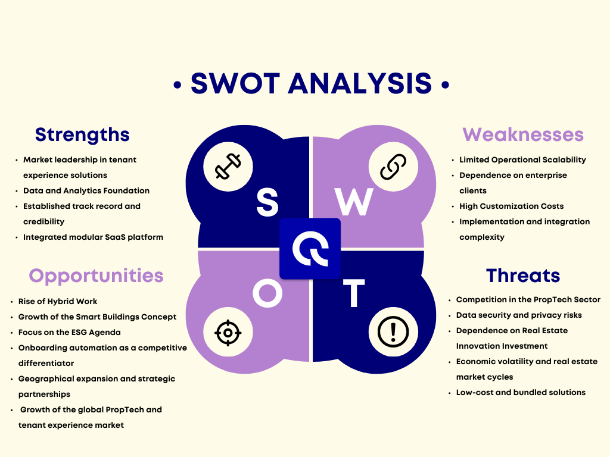
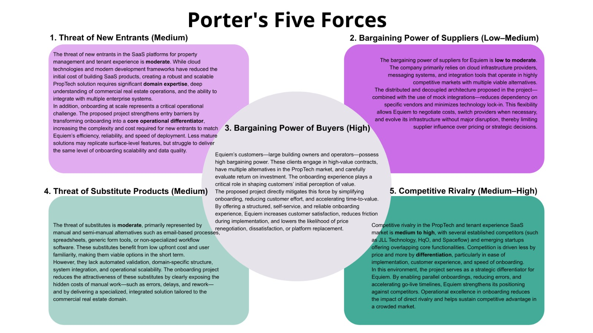
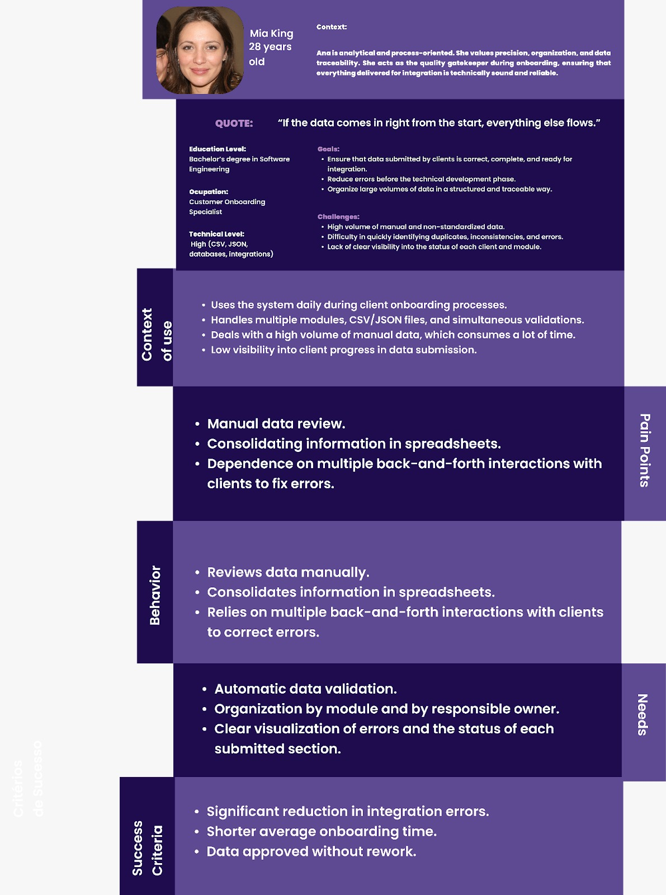
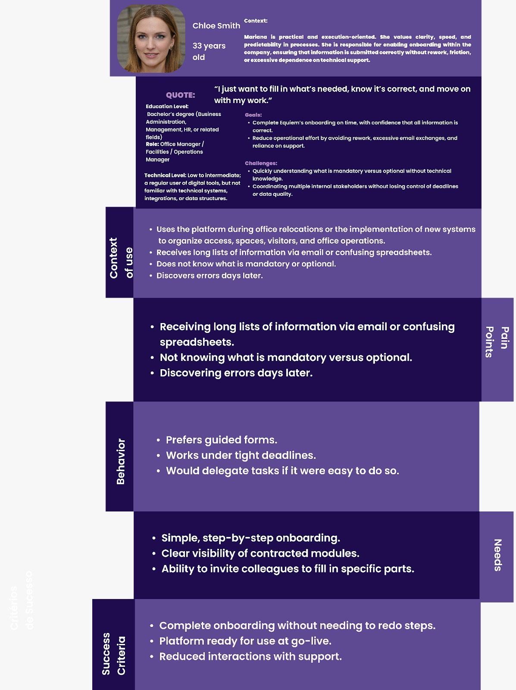
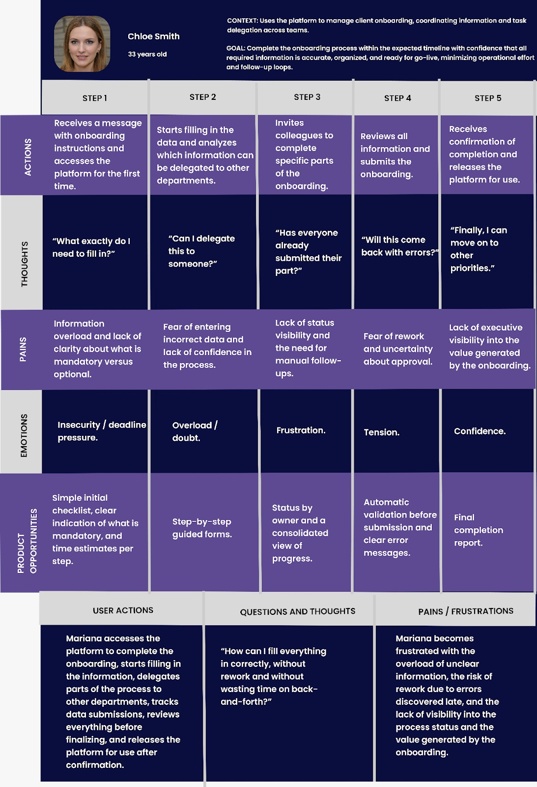
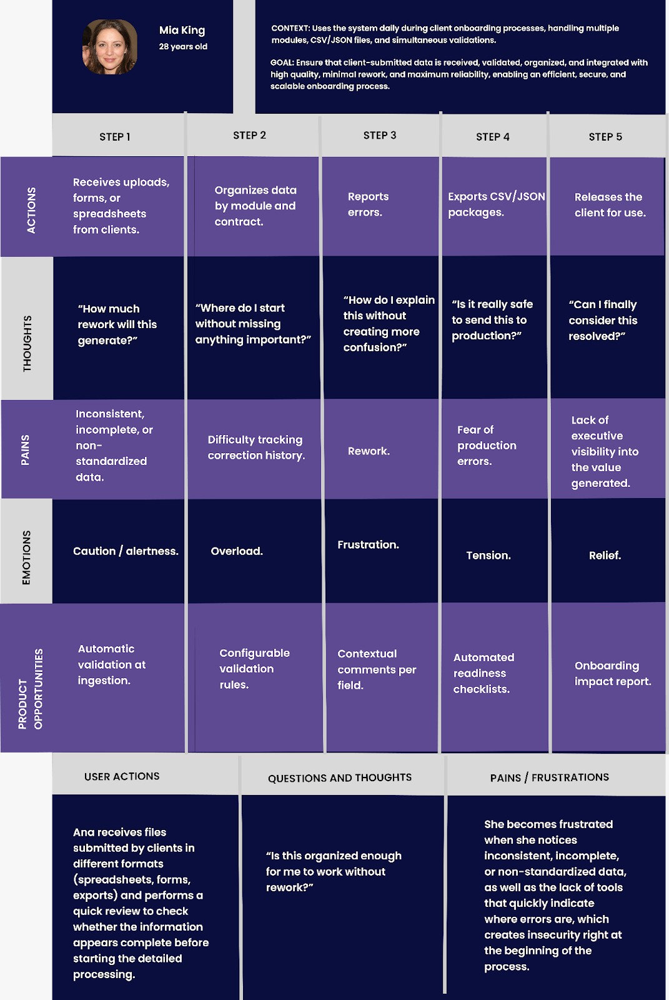
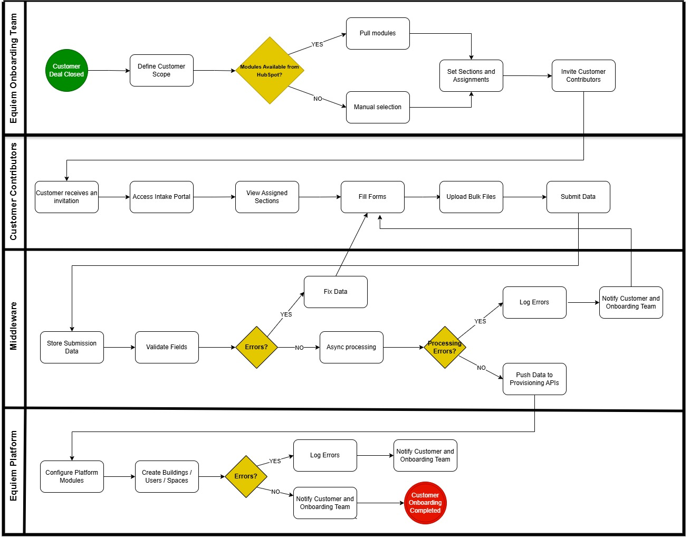
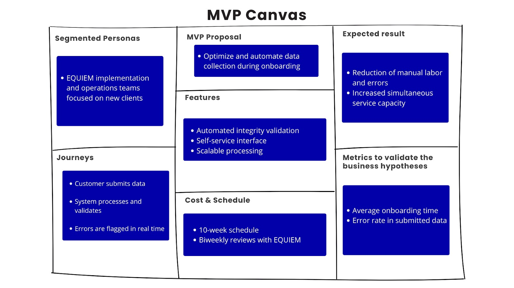
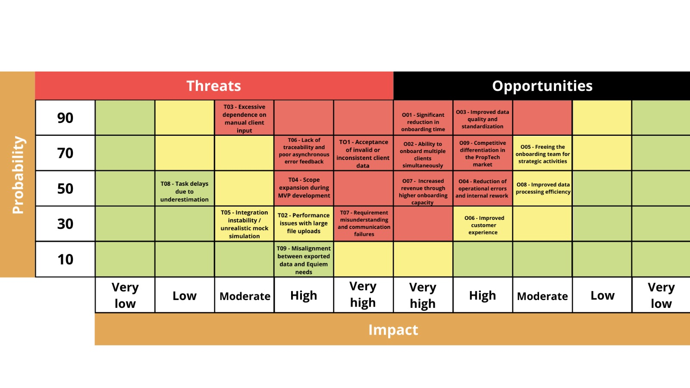
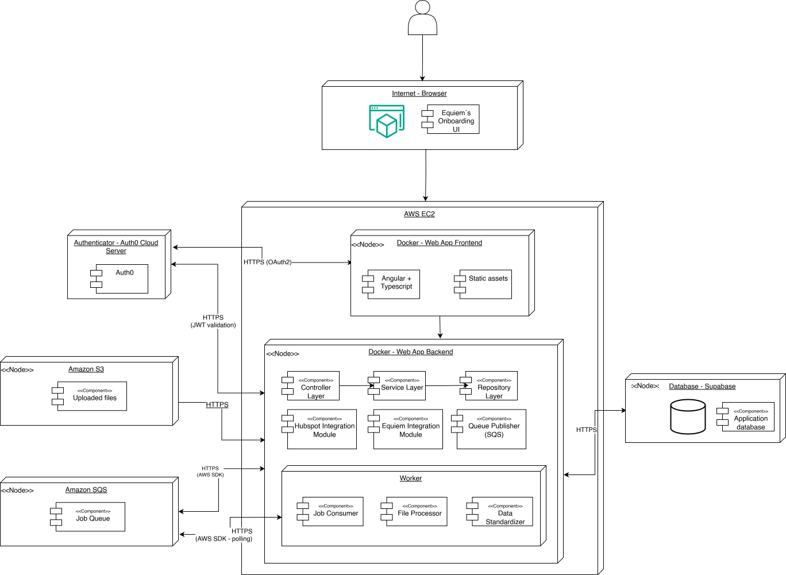

# Project Documentation: Business Analysis and Requirements Specification

## Table of Contents

- [Project Documentation: Business Analysis and Requirements Specification](#project-documentation-business-analysis-and-requirements-specification)
  - [Table of Contents](#table-of-contents)
  - [1. Introduction](#1-introduction)
  - [2. Problem](#2-problem)
  - [3. Partner Industry Context](#3-partner-industry-context)
  - [4. SWOT Analysis](#4-swot-analysis)
    - [4.1. Strengths](#41-strengths)
    - [4.2. Weaknesses](#42-weaknesses)
    - [4.3. Opportunities](#43-opportunities)
    - [4.4. Threats](#44-threats)
  - [5. Porter's Five Forces](#5-porters-five-forces)
    - [5.1. Threat of New Entrants (Medium)](#51-threat-of-new-entrants-medium)
    - [5.2. Bargaining Power of Suppliers (Low–Medium)](#52-bargaining-power-of-suppliers-lowmedium)
    - [5.3. Bargaining Power of Buyers (High)](#53-bargaining-power-of-buyers-high)
    - [5.4. Threat of Substitute Products (Medium)](#54-threat-of-substitute-products-medium)
    - [5.5. Competitive Rivalry (Medium–High)](#55-competitive-rivalry-mediumhigh)
  - [6. Product Vision](#6-product-vision)
  - [7. What the Product Does / Does Not Do (Scope)](#7-what-the-product-does--does-not-do-scope)
    - [7.1 What the Product DOES](#71-what-the-product-does)
    - [7.2 What the Product DOES NOT](#72-what-the-product-does-not)
  - [8. Product Goal](#8-product-goal)
  - [9. Personas and User Journey](#9-personas-and-user-journey)
    - [9.1 Personas](#91-personas)
    - [9.2 User Journey](#92-user-journey)
  - [10. Business Flow](#10-business-flow)
  - [11. Feature Brainstorming](#11-feature-brainstorming)
  - [12. Delivery Sequencing and Prioritization](#12-delivery-sequencing-and-prioritization)
  - [Delivery Strategy and Prioritization](#delivery-strategy-and-prioritization)
    - [Prioritization Criteria](#prioritization-criteria)
  - [Sprint 2: Core Onboarding Foundation](#sprint-2-core-onboarding-foundation)
    - [Delivered in this sprint:](#delivered-in-this-sprint)
  - [Sprint 3: Submission and Data Reliability](#sprint-3-submission-and-data-reliability)
    - [Delivered in this sprint:](#delivered-in-this-sprint-1)
  - [Sprint 4: Parallel Work and Collaboration](#sprint-4-parallel-work-and-collaboration)
    - [Delivered in this sprint:](#delivered-in-this-sprint-2)
  - [Sprint 5: Large-Scale Processing](#sprint-5-large-scale-processing)
    - [Delivered in this sprint:](#delivered-in-this-sprint-3)
  - [Post-MVP Enhancements (Nice-to-Have)](#post-mvp-enhancements-nice-to-have)
  - [12.1 Feature Development Progress and Deviations](#121-feature-development-progress-and-deviations)
  - [13. MVP Canvas](#13-mvp-canvas)
    - [13.1. MVP Proposal](#131-mvp-proposal)
    - [13.2. Segmented Personas](#132-segmented-personas)
    - [13.3. Journeys](#133-journeys)
    - [13.4. Features](#134-features)
    - [13.5. Expected Results](#135-expected-results)
    - [13.6. Metrics to Validate](#136-metrics-to-validate)
    - [13.7. Cost & Schedule](#137-cost--schedule)
  - [14. Project Risk Matrix and Action Table](#14-project-risk-matrix-and-action-table)
    - [14.1. THREATS](#141-threats)
    - [14.2. OPPORTUNITIES](#142-opportunities)
  - [15. Definitions, Terms and Abbreviation](#15-definitions-terms-and-abbreviation)
  - [16. Functional Requirements (FRs)](#16-functional-requirements-frs)
    - [16.1. Functional Requirement Details](#161-functional-requirement-details)
      - [FR01 – Structured Onboarding Data Upload](#fr01--structured-onboarding-data-upload)
      - [FR02 – Data Standardization](#fr02--data-standardization)
      - [FR03 – Intermediate Data Persistence](#fr03--intermediate-data-persistence)
      - [FR04 – Data Validation and Conflict Detection](#fr04--data-validation-and-conflict-detection)
      - [FR05 – Safe Data Correction via Re-Submission](#fr05--safe-data-correction-via-re-submission)
      - [FR06 – Change Comparison Visualization](#fr06--change-comparison-visualization)
      - [FR07 – Automatic Progress Persistence](#fr07--automatic-progress-persistence)
      - [FR08 – Dynamic Onboarding Interface](#fr08--dynamic-onboarding-interface)
      - [FR09 – Section Dependency Enforcement](#fr09--section-dependency-enforcement)
      - [FR10 – Collaborative Section Assignment](#fr10--collaborative-section-assignment)
      - [FR11 – Onboarding Status and Feedback](#fr11--onboarding-status-and-feedback)
      - [FR12 – Data Consolidation and Secure Integration](#fr12--data-consolidation-and-secure-integration)
    - [16.2. Functional Requirements Validation Tests](#162-functional-requirements-validation-tests)
    - [16.3. Functional Negative Test Scenarios](#163-functional-negative-test-scenarios)
  - [17. Non-Functional Requirements (NFRs)](#17-non-functional-requirements-nfrs)
    - [17.1. Non-Functional Requirement Details](#171-non-functional-requirement-details)
      - [NFR01 – Data Integrity Compliance](#nfr01--data-integrity-compliance)
      - [NFR02 – Large File Handling and Responsiveness](#nfr02--large-file-handling-and-responsiveness)
      - [NFR03 – Processing Reliability](#nfr03--processing-reliability)
      - [NFR04 – Security](#nfr04--security)
      - [NFR05 – Concurrent Submission Handling](#nfr05--concurrent-submission-handling)
    - [17.2. Non-Functional Requirements Validation Tests](#172-non-functional-requirements-validation-tests)
    - [17.3. Non-Functional Negative Test Scenarios](#173-non-functional-negative-test-scenarios)
  - [18. Functional Test Execution Strategy](#18-functional-test-execution-strategy)
    - [Test Execution Instructions](#test-execution-instructions)
  - [19. Non-Functional Test Execution Strategy](#19-non-functional-test-execution-strategy)
    - [Execution Method](#execution-method)
  - [20. Testing Tools and Environment](#20-testing-tools-and-environment)
    - [Automated Test Frameworks](#automated-test-frameworks)
  - [21. Test Coverage Discussion](#21-test-coverage-discussion)
    - [21.1 Unit Tests (Backend): Strategy, Implementation, and Coverage](#211-unit-tests-backend-strategy-implementation-and-coverage)
  - [22. FR–NFR Correlation Matrix](#22-frnfr-correlation-matrix)
  - [23. User Stories and Traceability](#23-user-stories-and-traceability)
    - [User Stories](#user-stories)
    - [User Stories and FR Traceability](#user-stories-and-fr-traceability)
    - [24. Revision of the Proposed Solution](#24-Revision-of-the-Proposed-Solution)
  - [25. Deployment Architecture](#25-deployment-architecture)
    - [25.1. Overview](#251-overview)
    - [25.2. System Infrastructure](#252-system-infrastructure)
    - [25.3. Frontend Deployment](#253-frontend-deployment)
    - [25.4. Backend Deployment](#254-backend-deployment)
    - [25.5. Messaging Infrastructure](#255-messaging-infrastructure)
    - [25.6. Worker Processing Layer](#256-worker-processing-layer)
    - [25.7. Database Layer](#257-database-layer)
    - [25.8. Authentication Service](#258-authentication-service)
    - [25.9. Communication Protocols](#259-communication-protocols)
    - [25.10. Deployment Rationale](#2510-deployment-rationale)
    - [25.11. Performance Considerations](#2511-performance-considerations)
    - [25.12. Security Considerations](#2512-security-considerations)

## 1. Introduction

This document presents the Business Analysis and Requirements Specification for the proposed onboarding intake solution. It consolidates the problem definition, industry context, product vision, scope boundaries, functional and non-functional requirements, delivery strategy, and risk considerations. The purpose of this document is to provide a clear and structured foundation for aligning business objectives with technical implementation, ensuring that the solution effectively addresses the identified operational challenges while remaining scalable, reliable, and aligned with the MVP strategy.

## 2. Problem

Equiem operates a SaaS platform that requires a large volume of customer-specific data to be collected, validated, and configured before a customer can successfully launch the platform. This onboarding data includes information about buildings, spaces, users, permissions, branding, and operational rules, and is often provided by multiple customer-side stakeholders. Currently, this data intake and validation process is highly manual, decentralized, and primarily managed through emails and spreadsheets, creating a critical operational bottleneck in Equiem’s onboarding workflow.

The absence of a structured and automated data intake layer means that onboarding analysts receive raw, inconsistent files in varying formats and levels of completeness. Without automated mechanisms or validation checkpoints at the point of entry, Equiem’s onboarding team must spend a disproportionate amount of time performing manual data hygiene tasks. This manual process slows down onboarding. Small data mistakes cause repeated back-and-forth with customers, often delayed by time zones and multiple people involved, which pushes back platform launch and increases early frustration.

In addition to inefficiency, the lack of automated validation at the data entry point introduces substantial risks to data integrity. Incomplete records, schema violations, and duplicated or inconsistent data may enter the system, requiring complex downstream corrections. These issues can cause functional failures in the live platform and compromise the reliability of operational and business intelligence reporting, undermining trust in the system.

Both internal and external users are negatively impacted by this problem. Internally, Equiem’s onboarding and customer experience teams are constrained by manual processes and operational friction. Externally, customer administrators and project managers lack a clear, structured, and collaborative way to understand onboarding requirements, track progress, and coordinate contributions. Together, these challenges result in a slower, less transparent, and more error-prone onboarding experience that weakens early perceptions of the platform’s value.

## 3. Partner Industry Context

Equiem is a global leader in property technology (PropTech) that helps commercial real estate owners and operators transform their buildings into connected, human-centric environments. It provides a unified digital platform designed to enhance tenant engagement, streamline building operations, and deliver actionable data insights, enabling property teams to manage communication, amenities, workspace services, and community experiences in one place. Equiem’s platform is deployed in hundreds of buildings across more than 25 countries and is used by hundreds of thousands of tenants and occupiers worldwide, demonstrating strong adoption and scalability.

The commercial real estate industry is increasingly driven by tenant expectations for seamless digital experiences, hybrid work dynamics, and demand for data-driven decision-making. As landlords seek to attract and retain tenants in competitive markets, there is growing pressure to modernize how property services are delivered and how tenant data is collected and utilized. Traditional manual methods of onboarding and engagement, often relying on email and spreadsheets, are becoming inefficient and error-prone in this context. Equiem’s platform addresses these demands by offering a comprehensive SaaS solution that consolidates engagement, operations, and analytics, helping owners increase tenant satisfaction and unlock additional asset value.

## 4. SWOT Analysis

The SWOT Analysis is a strategic planning tool used to evaluate an organization’s internal factors (strengths and weaknesses) and external factors (opportunities and threats) that influence its competitive position and long-term performance. In the context of this project, the SWOT Analysis provides a structured view of Equiem’s position within the global PropTech market and highlights how improving onboarding and data intake directly supports scalability, efficiency, and growth objectives.

<div align="center">
<sub>FIGURE 1 - SWOT Analysis</sub><br>
  <br>
  <sup>Source: Material produced by the authors, 2026.</sup>
</div>

### 4.1. Strengths

- **Pioneering and Specialization in Tenant Experience:** Equiem holds a competitive advantage as a category creator in tenant experience, offering a mature product that has been rigorously tested across diverse global markets.

- **Global Presence:** Operating across multiple continents demonstrates institutional solidity and the capacity to service large-scale international real estate portfolios.

- **Data and Analytics Foundation:** The platform transforms subjective occupant interactions into actionable data, enabling landlords to make evidence-based decisions regarding occupancy and asset value.

### 4.2. Weaknesses

- **Limited Operational Scalability:** The absence of a system architecture capable of simultaneous ingestion and processing of data streams from multiple new clients creates an operational bottleneck. This inability to concurrently collect and integrate large volumes of data from various sources delays the onboarding of new accounts and limits the company's agility during rapid market expansion phases.

- **Long Sales Cycle:** The corporate real estate sector is characterized by slow and conservative decision-making processes, requiring significant investments of time and capital before closing new contracts.

- **High Customization Costs:** The necessity to adapt interfaces and services to different building types and regional cultures increases operational expenses and reduces profit margins per unit.

### 4.3. Opportunities

- **Rise of Hybrid Work:** The new labor paradigm requires offices to become attractive destinations; Equiem’s technology provides the solution to manage this transition and entice employees back to physical workspaces.

- **Growth of the Smart Buildings Concept:** The increasing digitalization of urban infrastructure paves the way for Equiem to become the central operating system for intelligent and connected buildings.

- **Focus on the ESG Agenda:** The platform can serve as the official channel for collecting social well-being and energy efficiency data, assisting owners in meeting global sustainability targets.

### 4.4. Threats

- **Competition in the PropTech Sector:** The entry of new players with low-cost models or Big Tech companies offering integrated collaboration tools poses a significant risk to market share.

- **Information Security Risks:** As the platform manages physical access and personal data, digital vulnerabilities or cyberattacks could result in severe reputational and legal damage.

- **Dependence on Real Estate Innovation Investment:** In scenarios of economic crisis or high vacancy rates, property owners may cut budgets for non-essential technologies, directly impacting company revenue.

## 5. Porter's Five Forces

<div align="center">
<sub>FIGURE 2 - Porter´s Five Forces</sub><br>
  <br>
  <sup>Source: Material produced by the authors, 2026.</sup>
</div>

### 5.1. Threat of New Entrants (Medium)

The threat of new entrants in the SaaS platforms for property management and tenant experience is moderate. While cloud technologies and modern development frameworks have reduced the initial cost of building SaaS products, creating a robust and scalable PropTech solution requires significant domain expertise, deep understanding of commercial real estate operations, and the ability to integrate with multiple enterprise systems.

In addition, onboarding at scale represents a critical operational challenge. The proposed project strengthens entry barriers by transforming onboarding into a core operational differentiator, increasing the complexity and cost required for new entrants to match Equiem’s efficiency, reliability, and speed of deployment. Less mature solutions may replicate surface-level features, but struggle to deliver the same level of onboarding scalability and data quality.

### 5.2. Bargaining Power of Suppliers (Low–Medium)

The bargaining power of suppliers for Equiem is low to moderate. The company primarily relies on cloud infrastructure providers, messaging systems, and integration tools that operate in highly competitive markets with multiple viable alternatives.

The distributed and decoupled architecture proposed in the project—combined with the use of mock integrations—reduces dependency on specific vendors and minimizes technology lock-in. This flexibility allows Equiem to negotiate costs, switch providers when necessary, and evolve its infrastructure without major disruption, thereby limiting supplier influence over pricing or strategic decisions.

### 5.3. Bargaining Power of Buyers (High)

Equiem’s customers, large building owners and operators, possess high bargaining power. These clients engage in high-value contracts, have multiple alternatives in the PropTech market, and carefully evaluate return on investment. The onboarding experience plays a critical role in shaping customers’ initial perception of value.

The proposed project directly mitigates this force by simplifying onboarding, reducing customer effort, and accelerating time-to-value. By offering a structured, self-service, and reliable onboarding experience, Equiem increases customer satisfaction, reduces friction during implementation, and lowers the likelihood of price renegotiation, dissatisfaction, or platform replacement.

### 5.4. Threat of Substitute Products (Medium)

The threat of substitutes is moderate, primarily represented by manual and semi-manual alternatives such as email-based processes, spreadsheets, generic form tools, or non-specialized workflow software. These substitutes benefit from low upfront cost and user familiarity, making them viable options in the short term.

However, they lack automated validation, domain-specific structure, system integration, and operational scalability. The onboarding project reduces the attractiveness of these substitutes by clearly exposing the hidden costs of manual work, such as errors, delays, and rework, and by delivering a specialized, integrated solution tailored to the commercial real estate domain.

### 5.5. Competitive Rivalry (Medium–High)

Competitive rivalry in the PropTech and tenant experience SaaS market is medium to high, with several established competitors (such as JLL Technology, HqO, and Spaceflow) and emerging startups offering overlapping core functionalities. Competition is driven less by price and more by differentiation, particularly in ease of implementation, customer experience, and speed of onboarding.

In this environment, the project serves as a strategic differentiator for Equiem. By enabling parallel onboardings, reducing errors, and accelerating go-live timelines, Equiem strengthens its positioning against competitors. Operational excellence in onboarding reduces the impact of direct rivalry and helps sustain competitive advantage in a crowded market.

## 6. Product Vision

The product’s vision is to transform Equiem’s customer onboarding from a manual, fragmented, and operationally heavy process into a streamlined, self-service, collaborative, and reliable digital experience. Rather than improving existing spreadsheet-based workflows, the product fundamentally re-engineers how customer data is collected, validated, and prepared, positioning onboarding as the first tangible demonstration of Equiem’s efficiency, scalability, and technological leadership.
Designed specifically around Equiem’s onboarding reality, the product serves as a centralized intake platform that guides customers in submitting all required configuration data in a structured and intuitive way. It adapts dynamically to each customer’s purchased modules, clearly communicates what information is needed, and reduces uncertainty through guided flows, visual cues, and real-time feedback. This client-centric approach minimizes administrative burden on non-technical users while enabling multiple contributors to collaborate in parallel.

At the same time, the product automatically structures, organizes, and qualifies the information received. By embedding validation and standardization at the point of entry, it improves data quality and consistency, significantly reducing the manual effort currently required from Equiem’s onboarding team to interpret, clean, and reconcile customer-provided files. Time previously spent managing emails, spreadsheets, and clarification cycles can instead be redirected to higher-value activities, such as solution design and customer success.
The product is intentionally positioned as a self-service intake layer and proof of concept, not a full onboarding automation or provisioning platform. Its role is to prepare clean, reliable, and onboarding-ready data, enabling faster project starts without replacing Equiem’s internal tools or expertise.

Ultimately, the product exists to accelerate time-to-launch, reduce rework, and enable scalable onboarding operations. By supporting asynchronous data submission, automated validation, and parallel onboarding flows, it allows Equiem to grow onboarding capacity without a proportional increase in manual workload. In doing so, it strengthens collaboration between Equiem and its customers and delivers a more transparent, predictable, and efficient onboarding experience, benefiting both operational performance and customer perception.

## 7. What the Product Does / Does Not Do (Scope)

### 7.1 What the Product DOES

- Provide authenticated access, ensuring that all submissions and reviews are tied to identifiable users

- Guide customers in submitting onboarding data through dynamic web forms and bulk uploads

- Dynamically adapt required forms and sections based on purchased modules

- Support multiple contributors, allowing users to complete assigned sections independently and in parallel

- Validate required fields, data types, and basic conflicts at the point of entry

- Organize submitted data into structured and standardized formats for review and export

- Handle large files and high-volume datasets without blocking the user interface

- Use asynchronous background processing for validation and data preparation

- Allow multiple onboarding projects to be processed simultaneously

- Make clean, onboarding-ready data available through exportable CSV/JSON outputs

### 7.2 What the Product DOES NOT

- Generate, infer, or enrich business data beyond what users explicitly submit

- Guarantee zero errors without user correction or onboarding review

- Perform real-time provisioning or configuration of Equiem’s production systems

- Replace onboarding specialists or customer support teams

- Include advanced analytics, dashboards, charts, or decision-support tools

- Perform complex cross-system data reconciliation or bidirectional synchronization

- Store or expose restricted customer Help Center content

## 8. Product Goal

The goal of the product is to reduce onboarding effort and time-to-launch by replacing Equiem’s manual, email-based data collection process with a structured, self-service, and validated onboarding intake system. The product enables customers to submit all required onboarding information through a clear and guided flow, ensuring that data is complete, consistent, and ready for use by Equiem’s onboarding teams.

By automating data collection and validation, the solution reduces manual work, minimizes back-and-forth communication, and shortens the overall onboarding cycle. At the same time, it allows multiple onboarding projects to run in parallel, increasing scalability without a proportional increase in operational resources.

From a business perspective, the product lowers operational costs, improves onboarding throughput, and creates a reusable foundation for future automation and data migration initiatives. From a user perspective, it provides customers with a transparent and intuitive understanding of what data is required and how to submit it, while freeing Equiem’s onboarding team to focus on higher-value activities such as customer support, configuration review, and relationship building.

## 9. Personas and User Journey

### 9.1 Personas

<div align="center">
<sub>FIGURE 3 – Persona 1: Mia King (Onboarding Specialist – Equiem)</sub><br>
  <br>
  <sup>Source: Material produced by the authors, 2026.</sup>
</div>

<div align="center">
<sub>FIGURE 4 – Persona 2: Chloe Smith (Office Manager)</sub><br>
  <br>
  <sup>Source: Material produced by the authors, 2026.</sup>
</div>

### 9.2 User Journey

<div align="center">
<sub>FIGURE 5 – User Journey 1: Mia King (Onboarding Specialist – Equiem)</sub><br>
  
  <sup>Source: Material produced by the authors, 2026.</sup>
</div>

<div align="center">
<sub>FIGURE 6 – User Journey 2: Chloe Smith (Office Manager)</sub><br>
  
  <sup>Source: Material produced by the authors, 2026.</sup>
</div>

## 10. Business Flow

This business flow illustrates the target process enabled by our proposed solution. It introduces a middleware component into the onboarding journey, positioned between customer data submission and platform provisioning. Its role is to centralize data intake, standardize validations, and structure information before it reaches internal systems, creating a more organized, scalable, and efficient onboarding experience.

<div align="center">
<sub>FIGURE 7 – Business Flow</sub><br>
  <br>
  <sup>Source: Material produced by the authors, 2026.</sup>
</div>

With the addition of the middleware layer, the onboarding process becomes more resilient, faster, and easier to manage. Automated validations, asynchronous processing, and structured data packaging reduce manual effort while improving data quality and operational efficiency for both customers and internal teams.

## 11. Feature Brainstorming

|     | Feature                                                    |
| --- | ---------------------------------------------------------- |
| 1   | Manual module selection fallback                           |
| 2   | Module-driven dynamic form rendering                       |
| 3   | Conditional section visibility                             |
| 4   | Section assignment to contributors                         |
| 5   | Multi-contributor parallel editing                         |
| 6   | Hierarchical section dependency locking                    |
| 7   | Section status management (Not Started → Completed/Failed) |
| 8   | Autosave and save-as-draft                                 |
| 9   | CSV file upload                                            |
| 10  | XLSX file upload                                           |
| 11  | Multi-file upload support                                  |
| 12  | Large file upload support                                  |
| 13  | Asynchronous file processing                               |
| 14  | Data standardization engine                                |
| 15  | Schema validation (100% compliance)                        |
| 16  | Required field validation                                  |
| 17  | Data type validation                                       |
| 18  | Business rule validation                                   |
| 19  | Duplicate detection                                        |
| 20  | Staging area persistence                                   |
| 21  | Reprocessing capability                                    |
| 22  | Safe overwrite (upsert) logic                              |
| 23  | Version comparison (diff visualization)                    |
| 24  | Reviewer approval/rejection workflow                       |
| 25  | Section resubmission handling                              |
| 26  | CSV export (per section or full project)                   |
| 27  | JSON export (per section or full project)                  |
| 28  | Secure API push (JWT authentication)                       |
| 29  | Automatic retry logic for API calls                        |
| 30  | Bulk database updates                                      |
| 31  | User authentication                                        |
| 32  | Role-based access control                                  |
| 33  | Log In–based user invitations                              |
| 34  | Section-level permission control                           |
| 35  | Processing notifications (success/failure)                 |

## 12. Delivery Sequencing and Prioritization

## Delivery Strategy and Prioritization

Considering that **Sprint 1** is dedicated to business analysis and problem understanding, feature delivery begins in **Sprint 2**.  
The sequencing of deliveries was defined based on clear prioritization criteria aligned with the MVP objective.

### Prioritization Criteria

- Impact on the core problem
- Technical dependencies
- Data integrity and operational reliability
- Operational scalability
- Processing and architectural complexity

## Sprint 2: Core Onboarding Foundation

Users can securely access the platform and follow a guided onboarding flow.  
The interface is structured so customers know what to submit, and templates help standardize data.

### Delivered in this sprint:

- Secure authentication
- Clear submission interface
- Standardized templates

## Sprint 3: Submission and Data Reliability

Users can upload files, preview them, and save progress.  
Validation ensures the data is complete and correct before submission.

### Delivered in this sprint:

- File uploads
- File preview before submission
- Save progress across sessions
- Real-time validation
- Mandatory field checks
- Duplicate detection
- Clear error messages

## Sprint 4: Parallel Work and Collaboration

Multiple onboarding processes can run simultaneously, and multiple stakeholders can collaborate within each onboarding.

### Delivered in this sprint:

- Parallel onboarding processes
- Collaborative onboarding completion

## Sprint 5: Large-Scale Processing

The final MVP sprint focuses on technical scalability.  
The system becomes capable of handling very large uploads and processing them asynchronously without blocking the interface.

### Delivered in this sprint:

- Support for very large uploads
- Scalable file processing

## Post-MVP Enhancements (Nice-to-Have)

If time allows, the team may implement additional enhancements such as:

- Role-based access
- Progress indicators
- Version history
- Tooltips
- Dark mode

## 12.1 Feature Development Progress and Deviations

This section documents the implementation status of each planned feature and any deviations from the original plan (Section 11 – Feature Brainstorming, Section 12 – Delivery Sequencing, and Section 16 – Functional Requirements). It is updated as development advances.

### Functional Requirement Coverage in This Artefact (50%)

For this artefact, the team scope was to cover **half of the functional requirements** defined in Section 16.

- Total FRs in the project: **12**
- FRs covered in this artefact scope: **6/12 (50%)**

Covered FR scope in this artefact:

- **FR01** – Structured Onboarding Data Upload (**implemented**)
- **FR02** – Data Standardization (**implemented**)
- **FR03** – Intermediate Data Persistence (**partially covered / deviated**)  
  Current implementation persists state only in client session storage.
- **FR07** – Automatic Progress Persistence (**partially covered / deviated**)  
  Current implementation is session-based only.
- **FR08** – Dynamic Onboarding Interface (**implemented**)  
- **FR11** – Onboarding Status and Feedback (**partially covered / limited**)  
  Basic flow/error feedback exists, but full state model is not yet implemented.

### Summary by Planned Delivery

| Planned item (Sprint / FR) | Status | Implementation notes | Deviations |
| -------------------------- | ------ | ------------------- | ---------- |
| **Sprint 2: Secure authentication** | Done | Auth0 (JWT) + `GET /api/users`; redirect by user/company. Guard on `/home`, `/form`, `/upload`. | Main app uses Auth0 redirect flow; mock page (`user-mock-auth.html` + `user-mock-listener.js`) is available for token-based testing. |
| **Sprint 2: Clear submission interface** | Done | Angular SPA: Login, Signup, Home, Upload, Form; routes and guards. | README and early docs referred to Next.js; implemented stack is **Angular**. |
| **Sprint 2: Standardized templates** | Partial | Onboarding sections and questions from static `questions.json`; section labels and dynamic fields. | No server-side template engine; scope is fixed by JSON. |
| **Sprint 3: File uploads** (FR01) | Done | `POST /api/upload`; Angular `UploadComponent` and standalone `upload-page.html` + `upload-listener.ts`. CSV, XLSX, XLS. | Plan mentioned CSV and XLSX only; **XLS** also supported. Two front-end entry points (Angular and standalone). |
| **Sprint 3: File preview before submission** | Partial | User selects file and uploads; backend returns normalized data; form is pre-filled. | No dedicated “preview table” step before sending to backend. |
| **Sprint 3: Save progress across sessions** (FR07) | Partial | Progress and upload result stored in **sessionStorage** (section index, completed sections, uploaded data). | **Deviation:** No server-side persistence; progress is lost when the session ends or on another device. |
| **Sprint 3: Real-time validation** | Partial | Backend validates payload shape and normalizes keys; frontend shows upload errors. | No mandatory-field, format, or duplicate checks in backend yet. |
| **Sprint 3: Mandatory field checks** (FR04) | Not implemented | — | — |
| **Sprint 3: Duplicate detection** (FR04) | Not implemented | — | — |
| **Sprint 3: Clear error messages** | Done | 400/500 with `error` and `traceId`; frontend displays upload and auth errors. | — |
| **FR02: Data standardization** | Done | Backend normalizes spreadsheet keys (e.g. snake_case) in `upload-entity` and `upload-service`; typed DTO. | — |
| **FR03: Intermediate data persistence** | Deviation | No server-side staging or versioning. | Upload result and form state only in **sessionStorage**; no multi-version storage or controlled consolidation. |
| **FR04: Data validation and conflict detection** | Not implemented | — | — |
| **FR05: Safe data correction via re-submission** | Not implemented | — | — |
| **FR06: Change comparison visualization** | Not implemented | — | — |
| **FR07: Automatic progress persistence** | Partial | sessionStorage only (see above). | Same as “Save progress across sessions”. |
| **FR08: Dynamic onboarding interface** | Partial | Sections and dynamic fields from `questions.json`; navigation by section. | **Deviation:** No module-driven visibility; all sections from JSON are shown (no “active modules” filter). |
| **FR09: Section dependency enforcement** | Not implemented | — | — |
| **FR10: Collaborative section assignment** (Sprint 4) | Not implemented | — | — |
| **FR11: Onboarding status and feedback** | Partial | Basic feedback exists for auth/upload outcomes and flow transitions. | Full per-section/per-file finite states (Not Started, In Progress, Processing, Completed, Failed) are not implemented yet. |
| **FR12: Data consolidation and secure integration** | Not implemented | — | No CSV/JSON export or JWT-authenticated push to external systems. |
| **Sprint 4: Parallel onboarding / collaboration** | Not implemented | — | — |
| **Sprint 5: Large uploads / scalable processing** | Not implemented | — | Processing is **synchronous** in the request path; no async queue or large-file strategy. |

### Architecture and Standards Deviations

- **Frontend stack:** Project README and some docs referred to **Next.js** (components, pages). The application is implemented in **Angular** (Angular 18+), with Auth0 Angular SDK and Angular Router. This is a deliberate stack choice; docs should be read with Angular in mind.
- **Backend API:** Coding standards mention **GraphQL (Apollo)** and **TypeORM**. The current backend uses **REST (Express)** and **PostgreSQL** via `pg` (node-postgres). User and upload flows are REST endpoints; no GraphQL or ORM in use.
- **Persistence:** Staging and onboarding progress are **client-only** (sessionStorage). There is no server-side staging layer, versioning, or progress persistence for the onboarding form.

### Feature-to-File Traceability (Existing Files)

Below are only files that currently exist in the repository.

- **Authentication and user routing (Sprint 2 / FR scope support)**
  - `src/presentation/web/src/app/pages/login/login.component.ts`
  - `src/presentation/web/src/app/pages/signup/signup.component.ts`
  - `src/presentation/web/src/app/app.routes.ts`
  - `src/presentation/web/src/app/app.config.ts`
  - `src/presentation/api/routes/user-routes.ts`
  - `src/presentation/api/controllers/user-controllers.ts`
  - `src/presentation/api/middleware/auth-middleware.ts`
  - `src/business/services/user-service.ts`
  - `src/data/repositories/user-repository.ts`

- **Upload and normalization (FR01, FR02)**
  - `src/presentation/web/src/app/pages/upload/upload.component.ts`
  - `src/presentation/web/src/app/pages/upload/upload.component.html`
  - `src/presentation/web/pages/upload-page.html`
  - `src/presentation/web/scripts/upload-listener.ts`
  - `src/presentation/api/routes/upload-routes.ts`
  - `src/presentation/api/controllers/upload-controller.ts`
  - `src/business/services/upload-service.ts`
  - `src/business/entities/upload-entity.ts`
  - `src/business/dto/upload-row-dto.ts`

- **Onboarding form and dynamic sections (FR08 partial)**
  - `src/presentation/web/src/app/onboarding-form/onboarding-form.component.ts`
  - `src/presentation/web/src/app/onboarding-form/onboarding-form.component.html`
  - `src/presentation/web/src/app/components/dynamic-field/dynamic-field.component.ts`
  - `src/presentation/web/src/app/services/question.service.ts`
  - `src/presentation/web/public/questions.json`

- **Progress persistence (FR03/FR07 partial, client-side only)**
  - `src/presentation/web/src/app/pages/upload/upload.component.ts`
  - `src/presentation/web/src/app/onboarding-form/onboarding-form.component.ts`

### How to Run the Project Locally

To run the application, use **two terminals**: one for backend and one for frontend.

1. **Backend terminal**
   - Directory:
     - `g05/`
   - Command:
     - `npm run dev`

2. **Frontend terminal**
   - Directory:
     - `g05/src/presentation/web/`
   - Command:
     - `npm start`

3. **Expected ports**
   - Frontend (Angular): `http://localhost:4200`
   - Backend (Express): `http://localhost:3000`

4. **Important note**
   - The frontend uses proxy configuration (`proxy.conf.json`) for `/api` requests.
   - If backend is not running, frontend requests like `/api/users` will fail with `ECONNREFUSED`.

## 13. MVP Canvas

<div align="center">
<sub>FIGURE 8 – MVP Canvas</sub><br>
  <br>
  <sup>Source: Material produced by the authors, 2026.</sup>
</div>

### 13.1. MVP Proposal

The core focus of this MVP is the automation of the data ingestion layer. Currently, EQUIEM’s primary bottleneck lies in the initial configuration phase. The proposal is to replace manual spreadsheet handling with an intelligent system that optimizes response times and ensures the platform is ready for use in a fraction of the current timeframe.

### 13.2. Segmented Personas

The immediate target audience for this MVP is EQUIEM’s internal Implementation and Operations team. These professionals currently face significant workloads due to the manual processing of new client data. By providing better tools for them and the client’s managers, the MVP addresses the pain points of those operating the system behind the scenes.

### 13.3. Journeys

The redesigned journey focuses on Self-Service. The workflow shifts from an endless exchange of emails with attached files to a process defined by these stages:

- The client uploads data through a dedicated portal.
- The system performs immediate processing.
- If inconsistencies are found, the system flags the error instantly for the client to correct, preventing rework for the EQUIEM team.

### 13.4. Features

- Automated Data Integrity & Validation: Algorithms that verify if the data adheres to the platform's specific business rules.

- Client Self-Service Interface: An intuitive platform that provides the client with a direct interface for data uploads.

- Scalable High-Performance Processing: A cloud architecture designed to process large volumes of data from multiple clients concurrently, resolving the previously identified scalability weakness.

### 13.5. Expected Results

A drastic reduction in manual effort and implementation "Lead Time" is expected. By decreasing human intervention, we significantly reduce error rates and allow EQUIEM to scale its client base without needing to hire new data specialists for every new building contract.

### 13.6. Metrics to Validate

- Onboarding Time: Percentage reduction in time spent from contract signing to the system going "Live."

- Error Rate: The volume of data errors that reach the final system (the goal is near-zero).

- User Satisfaction (Internal): Feedback from the operations team regarding the ease of the new process.

### 13.7. Cost & Schedule

The project will be executed in a 10 week cycle. The governance structure includes Sprint Reviews with Equiem stakeholders to ensure development remains aligned with real business needs and to allow for rapid course corrections.

## 14. Project Risk Matrix and Action Table

<div align="center">
<sub>FIGURE 9 – Risk Matriz</sub><br>
  <br>
  <sup>Source: Material produced by the authors, 2026.</sup>
</div>

### 14.1. THREATS

| ID  | Risk                                                      | Explanation                                                                                                                            | P   | I   | Level (PxI) | Strategy          | Mitigation                                                                       | Contingency                                                              |
| --- | --------------------------------------------------------- | -------------------------------------------------------------------------------------------------------------------------------------- | --- | --- | ----------- | ----------------- | -------------------------------------------------------------------------------- | ------------------------------------------------------------------------ |
| T01 | Acceptance of invalid client data                         | Risk of accepting inconsistent, incomplete, or wrongly formatted data that may compromise processing integrity and system reliability. | 4   | 5   | 20          | Mitigate          | Implement automated schema validation and strict business rules before ingestion | Block processing and request corrected resubmission                      |
| T02 | Performance issues with large file uploads                | Risk of system slowdown or failure when handling large CSV/XLSX files with high data volume.                                           | 2   | 4   | 8           | Mitigate          | Perform load testing and use asynchronous queue processing                       | Temporarily scale infrastructure and split processing into batches       |
| T03 | Excessive dependence on manual client input               | High reliance on manual client actions, increasing chances of human error and delays.                                                  | 5   | 3   | 15          | Mitigate          | Provide standardized templates and validation rules                              | Create internal validation checkpoint before final ingestion             |
| T04 | Scope expansion during MVP development                    | Risk of adding new features during MVP phase, increasing complexity, cost, and delays.                                                 | 3   | 4   | 12          | Avoid             | Clearly define scope and implement formal change request process                 | Postpone additional features to next release cycle                       |
| T05 | Integration instability / unrealistic mock simulation     | Risk that mock simulations differ from real integration behavior, causing instability in production.                                   | 2   | 3   | 6           | Mitigate          | Develop test environment closer to real conditions and validate API contracts    | Quickly adjust integration adapters and prioritize hotfix                |
| T06 | Lack of traceability and poor asynchronous error feedback | Insufficient logging and unclear error feedback in asynchronous processing may reduce transparency and troubleshooting efficiency.     | 4   | 4   | 16          | Mitigate          | Implement structured logging and monitoring dashboards                           | Activate detailed logging mode and manually communicate issues to client |
| T07 | Requirement misunderstanding and communication failures   | Misinterpretation of requirements due to poor stakeholder alignment or unclear documentation.                                          | 2   | 5   | 10          | Mitigate          | Conduct refinement meetings and validate requirements frequently                 | Review backlog and replan sprint                                         |
| T08 | Task delays due to underestimation                        | Underestimating effort or complexity of tasks may cause sprint delays.                                                                 | 3   | 2   | 6           | Accept / Mitigate | Add buffer in sprint planning                                                    | Reprioritize backlog and redistribute tasks                              |
| T09 | Misalignment between exported data and Equiem needs       | Risk that exported standardized data does not fully match Equiem’s technical or business requirements.                                 | 1   | 4   | 4           | Avoid             | Validate technical requirements directly with Equiem                             | Develop temporary adaptation layer                                       |

### 14.2. OPPORTUNITIES

| ID  | Opportunity                                          | Explanation                                                                                                | P   | I   | Level (PxI) | Strategy | Exploitation Action                               | Benefit Realization Plan                             |
| --- | ---------------------------------------------------- | ---------------------------------------------------------------------------------------------------------- | --- | --- | ----------- | -------- | ------------------------------------------------- | ---------------------------------------------------- |
| O01 | Significant reduction in onboarding time             | Automation can significantly reduce the time required to onboard new clients compared to manual processes. | 5   | 5   | 25          | Exploit  | Automate as many onboarding steps as possible     | Use efficiency gain as a commercial differentiator   |
| O02 | Ability to onboard multiple clients simultaneously   | Scalable architecture enables parallel onboarding without proportional team increase.                      | 4   | 5   | 20          | Exploit  | Design scalable cloud-based infrastructure        | Expand sales strategy to target more clients         |
| O03 | Improved data quality and standardization            | Standardization improves consistency, integrity, and reliability of processed data.                        | 5   | 4   | 20          | Exploit  | Apply strict validation and normalization rules   | Create quality KPIs to showcase improvement          |
| O04 | Reduction of operational errors and internal rework  | Automation reduces manual mistakes and internal rework.                                                    | 3   | 4   | 12          | Enhance  | Implement automated validation and monitoring     | Reinvest saved time into optimization initiatives    |
| O05 | Freeing onboarding team for strategic activities     | Reduced manual workload allows team to focus on strategic and higher-value activities.                     | 4   | 3   | 12          | Enhance  | Redefine team responsibilities                    | Develop strategic roadmap using freed capacity       |
| O06 | Improved customer experience and transparency        | Providing status tracking and feedback increases customer trust and satisfaction.                          | 2   | 4   | 8           | Exploit  | Develop onboarding tracking dashboard             | Collect testimonials and feedback for marketing      |
| O07 | Increased revenue through higher onboarding capacity | Increased onboarding capacity may directly increase revenue generation.                                    | 3   | 5   | 15          | Exploit  | Expand commercial pipeline                        | Adjust pricing strategy aligned with higher capacity |
| O08 | Improved data processing efficiency                  | Optimization of asynchronous pipeline increases performance and reduces resource usage.                    | 3   | 3   | 9           | Enhance  | Optimize queue management and processing flow     | Publish efficiency KPIs internally                   |
| O09 | Competitive differentiation in the PropTech market   | Technological advantage may position the company as innovative within the PropTech sector.                 | 4   | 4   | 16          | Exploit  | Position solution as technological differentiator | Develop competitive comparison materials             |

## 15. Definitions, Terms and Abbreviation

| Term          | Definition                                                                                |
| ------------- | ----------------------------------------------------------------------------------------- |
| FR            | Functional Requirement                                                                    |
| NFR           | Non-Functional Requirement                                                                |
| MVP           | Minimum Viable Product                                                                    |
| BPMN          | Business Process Model and Notation                                                       |
| SaaS          | Software as a Service                                                                     |
| PropTech      | Property Technology                                                                       |
| SWOT          | Strengths, Weaknesses, Opportunities, and Threats                                         |
| API           | Application Programming Interface                                                         |
| JWT           | JSON Web Token                                                                            |
| CSV           | Comma-Separated Values                                                                    |
| XLSX          | Microsoft Excel Open XML Spreadsheet Format                                               |
| JSON          | JavaScript Object Notation                                                                |
| ISO/IEC 25010 | International standard for software product quality models                                |
| UI            | User Interface                                                                            |
| PDF           | Portable Document Format                                                                  |
| HubSpot       | Customer Relationship Management (CRM) platform used for module identification fallback   |
| CRM           | Customer Relationship Management                                                          |
| MB            | Megabyte                                                                                  |
| GB            | Gigabyte                                                                                  |
| Upsert        | Database operation that updates existing records or inserts new ones if they do not exist |
| Diff          | Difference comparison between two data versions                                           |

## 16. Functional Requirements (FRs)

| ID   | Title                                     | Functional Requirement Description                                                                                                                                                                                                                                                           |
| ---- | ----------------------------------------- | -------------------------------------------------------------------------------------------------------------------------------------------------------------------------------------------------------------------------------------------------------------------------------------------- |
| FR01 | Structured Onboarding Data Upload         | The system must allow authenticated users to submit onboarding data files (CSV and XLSX formats only) associated with a specific onboarding process through the onboarding submission interface. File size limits and responsiveness requirements are defined in NFR02. |
| FR02 | Data Standardization                      | The system must transform all submitted onboarding data into predefined internal data models and standardized field structures before any validation or consolidation occurs.                                                                                                                |
| FR03 | Intermediate Data Persistence             | The system must persist submitted onboarding data in an intermediate storage layer to enable validation, correction cycles, and controlled consolidation without overwriting previous versions or the final dataset prematurely.                                                             |
| FR04 | Data Validation and Conflict Detection    | The system must validate submitted onboarding data by checking: (1) presence of mandatory fields defined per dataset schema, (2) field data types, (3) format rules (date format YYYY-MM-DD, valid email pattern), and (4) uniqueness constraints based on predefined natural identifiers. The system must identify duplicate or conflicting records based on these identifiers.                                                                                                    |
| FR05 | Safe Data Correction via Re-Submission    | The system must allow users to correct invalid onboarding data by re-submitting updated files that safely replace previous entries based on natural identifiers defined for each dataset.                                                                                                    |
| FR06 | Change Comparison Visualization           | The system must present a comparison view that highlights differences between the latest and previous submission for the same dataset or section, focusing on changed fields or records.                                                                                                     |
| FR07 | Automatic Progress Persistence            | The system must automatically preserve onboarding progress across sessions, ensuring users can resume completion without re-entering previously submitted information.                                                                                                                       |
| FR08 | Dynamic Onboarding Interface              | The system must dynamically present onboarding sections based on the client’s active modules, ensuring that users only access forms and fields relevant to the selected configuration scope.                                                                                                 |
| FR09 | Section Dependency Enforcement            | The system must enforce dependencies between onboarding sections, preventing submission of dependent sections before prerequisite sections reach a "Completed" state as defined in FR11.                                                                                                                          |
| FR10 | Collaborative Section Assignment          | The system must enable collaborative onboarding by allowing administrators to assign sections to multiple contributors and support parallel completion of independent sections.                                                                                                              |
| FR11 | Onboarding Status and Feedback            | The system must track and display the following onboarding and processing states per section and per file submission: "Not Started", "In Progress", "Processing", "Completed", and "Failed". These states are finite and exclusive. The system must inform users when processing transitions to either "Completed" or "Failed".                                                              |
| FR12 | Data Consolidation and Secure Integration | The system must generate consolidated onboarding datasets in CSV or JSON format and transmit approved data packages to external systems via authenticated REST API calls using JWT-based authentication with signature validation.                                                                                                        |

### 16.1. Functional Requirement Details

#### FR01 – Structured Onboarding Data Upload

- Applies only to onboarding submission interfaces
- Accepts CSV and XLSX formats only
- File size and responsiveness constraints defined in NFR02

#### FR02 – Data Standardization

- Normalizes field names and data types
- Converts inputs into canonical internal structures
- Ensures consistency before validation

#### FR03 – Intermediate Data Persistence

- Stores multiple submission versions
- Prevents premature consolidation
- Enables inspection and reprocessing

#### FR04 – Data Validation and Conflict Detection

- Verifies required fields defined per dataset schema
- Applies explicit format and type validation rules
- Enforces uniqueness based on natural identifiers
- Detects duplicates and inconsistencies deterministically

#### FR05 – Safe Data Correction via Re-Submission

- Uses natural identifiers for replacement
- Avoids silent data inconsistencies
- Supports iterative correction

#### FR06 – Change Comparison Visualization

- Highlights modified, added, and removed data
- Improves review efficiency

#### FR07 – Automatic Progress Persistence

- Saves partial completion
- Retains accepted uploads

#### FR08 – Dynamic Onboarding Interface

- Displays only relevant onboarding sections
- Adapts to active modules

#### FR09 – Section Dependency Enforcement

- Controls onboarding flow order
- Requires prerequisite sections to be in "Completed" state

#### FR10 – Collaborative Section Assignment

- Distributes responsibilities
- Enables parallel completion

#### FR11 – Onboarding Status and Feedback

- Uses fixed states: Not Started, In Progress, Processing, Completed, Failed
- States are mutually exclusive
- Notifies users on state transition to Completed or Failed

#### FR12 – Data Consolidation and Secure Integration

- Generates export datasets in CSV or JSON
- Sends approved data via authenticated REST API using JWT
- Requires successful authentication before transmission

  ### 16.2. Functional Requirements Validation Tests

  | ID   | Test                    | Pre-condition            | Procedure                | Positive Scenario | Expected Result                                                                 | Post-condition           |
  | ---- | ----------------------- | ------------------------ | ------------------------ | ------------------------------------------------------------------------------ | ------------------------ | -- |
  | FR01 | Upload onboarding files | User authenticated       | Upload CSV/XLSX files ≤ size defined in NFR02 | A user uploads a valid 50MB CSV file containing correctly structured onboarding data. | File stored in staging layer and submission record created                     | Files stored in staging  | 
  | FR02 | Standardize data        | Files uploaded           | Trigger transformation   | The system processes a dataset with raw headers and varying date formats, successfully mapping them to the correct internal structure. |Output matches predefined internal schema without structural deviations        | Ready for validation     |
  | FR03 | Persist staging data    | Standardized data exists | Save to staging          | The user saves a standardized dataset, and the system stores it without overwriting any other data. |New version record created without overwriting previous versions               | Available for correction |
  | FR04 | Validate data           | Data in staging          | Run validation           | The system scans a dataset where all mandatory fields are present, types match, and no duplicate identifiers exist. | Validation report generated listing schema, format, or uniqueness violations   | Report generated         |
  | FR05 | Re-submit data          | Errors exist             | Upload corrected version | The user uploads a corrected file fixing previous errors; the system matches the natural identifiers and safely updates those specific records. |Records replaced only where natural identifiers match                          | Updated dataset stored   |
  | FR06 | Compare submissions     | Multiple versions        | Open comparison          | The user selects Version 1 and Version 2 of a dataset to review recent corrections. |System displays field-level differences between selected versions               | Review complete          |
  | FR07 | Resume onboarding       | Progress saved           | Reopen system            | A user logs out halfway through section completion and logs back in to resume their work. | Previously saved state restored without data loss                              | Flow continues           |
  | FR08 | Dynamic sections        | Modules set              | Open onboarding          | A client with only the "Tenant Experience" module activated logs in to view their required onboarding tasks. |Only sections mapped to active modules are rendered                            | Correct scope            |
  | FR09 | Enforce dependencies    | Parent not "Completed"   | Attempt child submission | A user successfully submits the "Building Info" parent section and attempts to access the "Space Info" child section. | System blocks submission and returns dependency validation message             | Flow maintained          |
  | FR10 | Assign contributors     | Admin authenticated      | Assign sections          | An admin assigns the "User Roles" section to a specific contributor, who logs in to edit it simultaneously. |Section assignment persisted and visible to assigned users                     | Parallel work enabled    |
  | FR11 | Track status            | Upload triggered         | Monitor states           | A user uploads a file and watches the UI for processing feedback until validation finishes successfully. | Status transitions follow defined state set and invalid states are rejected    | User informed            |
  | FR12 | Export & integrate      | Sections approved        | Generate and send        | The admin approves the final dataset, and the system transmits the JSON payload via the API. |API request sent with valid JWT; external system returns HTTP 2xx confirmation | External system updated  |

### 16.3. Functional Negative Test Scenarios
| ID | Functional Requirement | Negative Scenario | Expected Result |
| --- | --- | --- | --- |
| **FR01** | Structured Data Upload | Attempt to upload a prohibited file type (e.g., `.pdf`, `.exe`). | System blocks the upload and displays an "Invalid Format" error. |
| **FR02** | Data Standardization | Upload a file where column names do not match the required template. | System fails normalization and identifies the incorrect columns. |
| **FR03** | Intermediate Persistence | Attempt to access a submission version that has been deleted or does not exist. | System returns a "Resource Not Found" error. |
| **FR04** | Data Validation | Submit a file with invalid email patterns or duplicate natural identifiers. | System lists all specific errors and prevents data consolidation. |
| **FR05** | Safe Data Correction | Re-submit data where the natural identifier has been altered. | System treats it as a new record or alerts the user of the inconsistency. |
| **FR06** | Change Visualization | Attempt to compare a version with a corrupted or empty dataset. | System informs the user that comparison is not possible due to data gaps. |
| **FR07** | Progress Persistence | Close the browser during a large upload before the "Saved" confirmation. | System restores the last stable state without corrupted partial data. |
| **FR08** | Dynamic Interface | Attempt to access an inactive module's section via direct URL. | System redirects to the home page or displays "Access Denied". |
| **FR09** | Dependency Enforcement | Attempt to submit a child section while the parent is "In Progress". | System blocks submission and displays a dependency error. |
| **FR10** | Section Assignment | An unassigned user attempts to edit a section restricted to another collaborator. | System prevents editing and shows the section is locked/assigned. |
| **FR11** | Status Tracking | Simulate a connection failure during processing to test hangs. | System triggers a timeout and moves the status to "Failed". |
| **FR12** | Secure Integration | Attempt to push data while the target external system is offline. | System logs the integration failure and allows for a later retry. |


## 17. Non-Functional Requirements (NFRs)

| ID    | Title                                  | Non-Functional Requirement Description                                                                                                                                                    |
| ----- | -------------------------------------- | ----------------------------------------------------------------------------------------------------------------------------------------------------------------------------------------- |
| NFR01 | Strict Data Integrity and Consistency | The system shall maintain 100% data consistency across all storage layers, ensuring that no orphaned or schema-violating records exist within the production environment at any time. |
| NFR02 | Large File Handling | The system shall support onboarding file uploads of up to 100 MB per file and process them without causing application crashes, request timeouts, or interruption of other active user sessions.           |
| NFR03 | Processing Reliability                 | The system shall ensure transactional consistency during ingestion, validation, staging, and consolidation processes, preventing partial writes and automatically rolling back incomplete operations in case of failure.                                                       |
| NFR04 | Security  | All stored onboarding data must be encrypted at rest (AES-256) and in transit (TLS 1.2+), with access restricted through AWS IAM role-based policies.                                                       |
| NFR05 | Concurrent Submission Handling         | The system shall support multiple concurrent onboarding submissions and ensure that each submission is processed independently without data mixing, corruption, or validation inconsistency.                                                      |

### 17.1. Non-Functional Requirement Details

#### NFR01 – Data Integrity Compliance

- The system must validate 100% of uploaded records against the predefined internal schema.
- The system must reject any record that fails schema validation before it reaches the staging area.
- The system must prevent any dataset from proceeding to consolidation or export unless it has been fully validated.

#### NFR02 – Large File Handling and Responsiveness

- The system must accept file uploads up to 100 MB per file.
- File processing must occur without application crashes or unhandled exceptions.
- Uploading a large file must not terminate or block other active user sessions.
- Files exceeding 100 MB must be rejected with a clear validation message.

#### NFR03 – Processing Reliability

- 100% of failed transactions must be rolled back automatically.
- All ingestion, validation, and consolidation operations must execute within transactional boundaries.
- Incomplete or failed operations must be automatically rolled back.
- No partial writes shall persist in the database after a failure.

#### NFR04 – Security

- All stored onboarding data must be encrypted at rest using AES-256 encryption.
- All data transmitted between client and server must use TLS 1.2 or higher.
- Access to stored data must be restricted using AWS IAM role-based access control.
- Unauthorized access attempts must be denied by default.

#### NFR05 – Concurrent Submission Handling

- The system must support at least 10 multiple concurrent onboarding submissions.
- Each submission must be processed independently.
- Concurrent processing must not cause data mixing between submissions.

### 17.2. Non-Functional Requirements Validation Tests

| ID    | Test                                            | Pre-condition                                            | Procedure                                                          | Positive Scenario |Expected Result                                                                                                        | Post-condition                               |
| ----- | ----------------------------------------------- | -------------------------------------------------------- | -----| ------------------------------------------------------------------ | ---------------------------------------------------------------------------------------------------------------------- | -------------------------------------------- |
| NFR01 | Strict Data Integrity and Consistency                   | System is active with a predefined schema; a dataset containing valid and invalid records. | Execute schema validation process                                  | A dataset with 500 valid records and 5 schema-violating records is ingested; the system successfully identifies and filters the corrupted data automatically. | 100% of invalid records are blocked                                            | System remains in a 100% consistent state with no corrupted data.              |
| NFR02 | Maximum file size handling                      | User authenticated                                       | Upload file ≤ 100 MB and upload file > 100 MB                      | A user uploads a dense, 98 MB .xlsx file containing thousands of rows, and the system processes it seamlessly. |Files ≤ 100 MB are processed successfully; files > 100 MB are rejected with validation message; no system crash occurs | Valid file ingested; oversized file rejected |
| NFR03 | Transaction rollback verification               | Processing operation active                              | Force system interruption during database write operation          | A database connection is intentionally interrupted mid-write, and the system successfully triggers its automated rollback protocol to protect the dataset. |  100% of interrupted transactions are rolled back; no partial writes persist in database                                | Database remains in consistent state         |
| NFR04 | Data encryption and access control verification | System deployed in production configuration              | Inspect storage configuration and attempt unauthorized data access | An authorized internal security tool audits the database and network layers to verify that all active encryption protocols are functioning correctly. | Data is encrypted at rest (AES-256); communication occurs via TLS 1.2+; unauthorized access attempt is denied          | Data remains protected                       |
| NFR05 | Concurrent submission handling                  | At least 10 users authenticated                          | Simulate 10 concurrent onboarding submissions                      | Ten independent customer administrators trigger massive dataset validations at the exact same second, and the system routes them safely into separate processing queues. | All 10 submissions are processed independently without data mixing or processing errors                                | All submissions completed correctly          |

### 17.3. Non-Functional Negative Test Scenarios
| ID | Non-Functional Requirement | Negative Scenario | Expected Result (Negative) |
| --- | --- | --- | --- |
| **NFR01** | Strict Data Integrity and Consistency | Manually insert a schema-violating record into the staging database and attempt a dataset export. | The export process detects the violation and rejects the dataset. |
| **NFR02** | Large File Handling | Attempt to upload a 105 MB file (exceeding the limit). | System instantly rejects the file and notifies the user of the 100 MB limit. |
| **NFR03** | Processing Reliability | Force a server shutdown during a database write operation. | Transaction is rolled back; no partial data persists in the database. |
| **NFR04** | Security | Attempt to access the endpoint without a token or with an expired JWT. | System returns HTTP 401 Unauthorized and blocks access. |
| **NFR05** | Concurrent Submissions | Two users attempt to save conflicting changes to the same section simultaneously. | System applies optimistic locking and alerts the second user. |

## 18. Functional Test Execution Strategy

The purpose of functional testing is to verify that the system behaves according to the defined Functional Requirements (FRs).  
Each test defined in section 16.2 validates a specific functional capability of the onboarding system.

Functional tests focus on verifying:

- correct onboarding data upload and processing
- proper transformation and standardization of datasets
- reliable staging and persistence mechanisms
- validation of data formats and schema compliance
- collaborative onboarding workflows
- correct enforcement of section dependencies
- accurate status tracking
- secure integration with external systems

### Test Execution Instructions

Functional tests are executed using integration testing in an isolated environment.

Test execution generally follows these steps:

1. Deploy the system in a controlled testing environment.
2. Initialize the database with the required schema.
3. Prepare test datasets (valid and invalid onboarding files).
4. Execute the system operation defined in the test procedure.
5. Observe the system output and behavior.
6. Compare the obtained results with the expected results defined in the test tables.

Integration tests are executed using **Testcontainers**, which allows the database and system dependencies to run inside isolated containers during testing. This ensures reproducibility and avoids the use of mocked components.

---

## 19. Non-Functional Test Execution Strategy

Non-functional tests verify system qualities that are critical for operational reliability and scalability.

The tests defined in section 17.2 validate the following aspects:

- data integrity
- performance and large file handling
- transactional reliability
- system security
- concurrent submission handling

### Execution Method

Non-functional tests are executed using controlled test environments where specific stress or failure conditions are simulated.

Examples include:

- uploading large datasets close to the 100 MB limit
- simulating concurrent onboarding submissions
- forcing transaction interruptions to validate rollback mechanisms
- verifying encryption and access control configurations

These tests confirm that the system maintains reliability, performance, and security under realistic operational conditions.

---

## 20. Testing Tools and Environment

The following tools are used to support test execution:

**Testcontainers**  
Used to create isolated containerized environments for integration testing.  
It allows the database and system dependencies to run inside containers, ensuring consistent test environments across development machines.

**PostgreSQL**  
Used as the primary database system during testing to validate persistence, transactions, and schema constraints.

**Automated Test Frameworks**

The system tests may be implemented using testing frameworks compatible with the project’s technology stack:

- **Jest / Vitest** for TypeScript components
- **Pytest** for Python services

These frameworks allow automated execution of integration and validation tests to verify system behavior against the defined requirements.

Mocks are not used for integration testing. Instead, real dependencies are executed inside containerized environments to ensure realistic behavior and accurate validation of system functionality.

---

## 21. Test Coverage Discussion

The defined test plan provides comprehensive coverage of the onboarding system’s functional and non-functional requirements.

Functional tests cover the entire onboarding workflow, including:

- onboarding data file upload
- dataset transformation and standardization
- intermediate staging persistence
- schema validation and conflict detection
- safe data correction and re-submission
- comparison between dataset versions
- dynamic onboarding interfaces
- enforcement of section dependencies
- collaborative onboarding workflows
- onboarding status tracking
- export and integration with external systems

Non-functional tests ensure that the system meets key operational requirements, including:

- strict schema compliance and data integrity
- large file handling capabilities
- transactional reliability during processing
- secure data storage and transmission
- concurrent submission handling

Together, these tests ensure that both business requirements and technical system constraints are validated.  
The combination of functional, non-functional, and usability tests provides strong verification of system correctness, reliability, and user experience.

### 21.1 Unit Tests (Backend): Strategy, Implementation, and Coverage

Unit tests for the backend and business layer are implemented with **Vitest** (Node environment) and documented below in a single place.

**Objective.** Ensure that the developed functionalities (backend and business layer) have automated unit tests, with mocks for external dependencies (database, HTTP), and that strategy, coverage, and results are documented.

**Scope.**

- **Included:** business layer (entities, DTOs, services), API controllers (upload, user), validations and data transformations.
- **Excluded (in this phase):** E2E tests, integration tests with a real database, frontend Angular tests (these already exist under `tests/presentation/` for upload, login, onboarding).

**Tools.**

- **Vitest** for execution and assertions (also used at project root for the backend).
- **Environment:** Node (services, mocked repositories, controllers).
- **Coverage:** `@vitest/coverage-v8` for coverage reports.

**Commands.**

| Command | Description |
|--------|-------------|
| `npm test` | Run all backend unit tests once |
| `npm run test:coverage` | Run tests and generate coverage (terminal + HTML in `coverage/`) |

**Test suites implemented.**

| Layer | File | Cases |
|-------|------|--------|
| Entities | `tests/business/entities/user-entity.spec.ts` | 4: `UserEntity.getEmailDomain()` (empty, no @, valid, multiple @) |
| Entities | `tests/business/entities/upload-entity.spec.ts` | 3: `UploadEntity.normalizeKeys()` (trim/lowercase/underscore, values, already normalized) |
| Services | `tests/business/services/upload-service.spec.ts` | 3: `mapRowsToEntities()` (null rows, empty array, valid rows) |
| Services | `tests/business/services/user-service.spec.ts` | 4: `checkUser()` (missing payload, existing user, new user with/without company; repository mocked) |
| Controllers | `tests/presentation/api/controllers/upload-controller.spec.ts` | 5: `handleUpload()` (400 missing/invalid rows, 200 with data/redirect, 500 on service error) |
| Controllers | `tests/presentation/api/controllers/user-controllers.spec.ts` | 5: `getPayload()` (401 no sub, 200 /monitoring and /company/:id, 403 company not registered, 500 on error) |

**Total:** 6 spec files, 24 tests, all passing.

**Directory layout.**

```
tests/
├── business/
│   ├── entities/   (user-entity.spec.ts, upload-entity.spec.ts)
│   └── services/   (upload-service.spec.ts, user-service.spec.ts)
└── presentation/
    └── api/controllers/   (upload-controller.spec.ts, user-controllers.spec.ts)
```

**Conventions.** One `*.spec.ts` file per tested module, mirroring `src/`. Use `vi.mock()` for DB/HTTP modules. Descriptive test names; Arrange–Act–Assert where appropriate.

**Coverage (V8).** Scope: `src/business/**/*.ts` and `src/presentation/api/**/*.ts`. Example summary:

| Metric | Value |
|--------|--------|
| Statements | ~86% |
| Branches | ~80% |
| Functions | ~73% |
| Lines | ~86% |

- **business/entities:** 100%.
- **business/services:** 100% statements/lines.
- **presentation/api/controllers:** ~97% statements/lines.
- **Routes and middleware:** not covered by these unit tests (thin wiring); can be covered by integration or E2E.

To refresh coverage numbers, run `npm run test:coverage` and check the terminal output or `coverage/index.html`.

## 22. FR–NFR Correlation Matrix

| FR ID | Related NFRs | Justification                                                                  |
| ----- | ------------ | ------------------------------------------------------------------------------ |
| FR01  | NFR02, NFR05 | Large uploads and concurrent submissions require responsiveness and stability. |
| FR02  | NFR01        | Standardization depends on strict schema integrity.                            |
| FR03  | NFR01, NFR03 | Staging requires integrity and fault tolerance.                                |
| FR04  | NFR01, NFR03 | Validation relies on clean data and reliable processing.                       |
| FR05  | NFR01, NFR03 | Safe replacement demands consistency and reliability.                          |
| FR06  | NFR01        | Accurate comparisons depend on standardized data.                              |
| FR07  | NFR03        | Progress saving requires reliable persistence.                                 |
| FR08  | NFR03        | Dynamic flows require consistent state handling.                               |
| FR09  | NFR03        | Dependency enforcement relies on reliability.                                  |
| FR10  | NFR05        | Collaboration requires stable concurrency.                                     |
| FR11  | NFR03        | Status tracking depends on reliable processing.                                |
| FR12  | NFR01, NFR03 | Export requires integrity and fault tolerance.                                 |

## 23. User Stories and Traceability

### User Stories

| ID   | User Story                                                                                                                 |
| ---- | -------------------------------------------------------------------------------------------------------------------------- |
| US01 | As a client project manager, I want to upload onboarding data files so that I can submit required information efficiently. |
| US02 | As a user, I want my data standardized so that validation is consistent.                                                   |
| US03 | As an analyst, I want submitted data staged safely before production.                                                      |
| US04 | As a user, I want validation feedback to correct errors early.                                                             |
| US05 | As a user, I want to re-submit corrected data safely.                                                                      |
| US06 | As an analyst, I want to compare submissions easily.                                                                       |
| US07 | As a user, I want progress saved automatically.                                                                            |
| US08 | As a user, I want only relevant onboarding sections displayed.                                                             |
| US09 | As a user, I want onboarding steps enforced logically.                                                                     |
| US10 | As a project manager, I want to assign sections to collaborators.                                                          |
| US11 | As a user, I want to track onboarding status clearly.                                                                      |
| US12 | As an analyst, I want approved data exported and integrated securely.                                                      |

### User Stories and FR Traceability

| User Story | Related FRs |
| ---------- | ----------- |
| US01       | FR01        |
| US02       | FR02        |
| US03       | FR03        |
| US04       | FR04        |
| US05       | FR05        |
| US06       | FR06        |
| US07       | FR07        |
| US08       | FR08        |
| US09       | FR09        |
| US10       | FR10        |
| US11       | FR11        |
| US12       | FR12        |

## 24. Revision of the Proposed Solution

The proposed solution establishes a structured and scalable foundation for transforming Equiem’s onboarding process from a fragmented, manual workflow into a reliable and strategically differentiated intake system. Through comprehensive business analysis, clear requirement definition, and a focused MVP strategy, the project directly addresses operational bottlenecks that currently limit efficiency, data integrity, and speed of deployment. By embedding validation, standardization, and collaborative capabilities at the point of data entry, the platform significantly reduces manual effort, minimizes rework, and enables parallel onboarding at scale. Ultimately, the initiative accelerates time-to-launch, enhances customer experience, and strengthens operational resilience, positioning onboarding not as a constraint, but as a sustainable competitive advantage for Equiem’s continued growth.

## 25. Deployment Architecture

### 25.1. Overview

The deployment diagram represents the **target production architecture** of the onboarding automation platform developed in partnership with Equiem.

The diagram illustrates how the system components are distributed across cloud infrastructure resources and how different services interact within the production environment. It presents the servers, middleware, services, and databases required to operate the system, as well as the communication protocols used between them.

The architecture follows a **distributed cloud-based deployment model**, separating the system into distinct layers responsible for presentation, application logic, asynchronous processing, and data persistence.

The main components of the architecture include:

- Web browser interface used by onboarding specialists
- Frontend web application deployed on cloud infrastructure
- Backend API services responsible for business logic
- Messaging infrastructure supporting asynchronous processing
- Worker services responsible for data processing tasks
- Managed relational database infrastructure
- External authentication services

The deployment architecture was designed to satisfy the project's non-functional requirements, particularly those related to performance, scalability, availability, and security.

Figure 10 illustrates the deployment architecture of the onboarding automation platform.

For better visualization, please access the following [link](https://drive.google.com/file/d/1jHnyVEm3KI1-ERu1pNhjq-7KT3i-hlVW/view?usp=sharing).

<div align="center">
<sub>FIGURE 10 – Deployment Architecture Diagram</sub><br>
  <br>
  <sup>Source: Material produced by the authors, 2026.</sup>
</div>

### 25.2. System Infrastructure

The system is deployed using cloud infrastructure services provided by **Amazon Web Services (AWS)**.

Different infrastructure nodes are used to host specific components of the system, allowing the architecture to remain modular and scalable.

The main infrastructure elements are:

| Infrastructure Component | Description |
|--|-|
| AWS EC2 (Frontend) | Hosts the web application frontend |
| AWS EC2 (Backend) | Hosts backend API services |
| AWS EC2 (Worker) | Hosts background worker services responsible for asynchronous processing |
| Amazon RDS | Managed relational database service used for persistent storage |
| Amazon SQS | Messaging middleware responsible for asynchronous job processing |
| Auth0 Cloud Service | External authentication and identity management provider |

All application services are deployed using **Docker containers**, ensuring consistent runtime environments and simplifying deployment and infrastructure management.

### 25.3. Frontend Deployment

The frontend application is deployed on an **AWS EC2 instance** within a Docker container environment.

The frontend is implemented using **Angular and TypeScript**, forming a single-page application responsible for presenting the onboarding interface used by administrators and onboarding specialists.

The frontend node contains the following components:

| Component | Description |
|-|-|
| Angular + TypeScript | Core frontend application responsible for rendering the onboarding UI |
| Static Assets | Compiled JavaScript files, stylesheets, and other UI resources |

Users interact with the system through a web browser. Requests are sent through the internet to the frontend server using **secure HTTPS connections**.

The frontend communicates with backend services through HTTPS API requests.

### 25.4. Backend Deployment

The backend application is deployed on a dedicated **AWS EC2 instance**, also running within a Docker container.

The backend follows a **layered architecture** that separates responsibilities into logical modules responsible for handling API requests, business logic, and database interaction.

The backend node includes the following components:

| Component | Responsibility |
|-|-|
| Controller Layer | Handles incoming HTTP requests and exposes REST API endpoints |
| Service Layer | Implements business logic and system workflows |
| Repository Layer | Handles database access and persistence operations |
| HubSpot Integration Module | Retrieves deal information and enabled modules |
| Equiem Integration Module | Prepares structured onboarding data for system integration |
| Queue Publisher | Sends asynchronous processing jobs to Amazon SQS |

This layered design improves maintainability, separation of concerns, and long-term system extensibility.

### 25.5. Messaging Infrastructure

The system incorporates **Amazon Simple Queue Service (SQS)** as a messaging middleware to support asynchronous processing.

When operations require heavy data processing, such as parsing uploaded onboarding files or validating large configuration datasets, the backend publishes job messages to the SQS queue.

The queue acts as a decoupling mechanism between the API layer and background processing services.

Using a messaging infrastructure provides several architectural benefits:

- decoupling between system components
- improved system scalability
- support for asynchronous workflows
- improved system reliability through retry mechanisms

This architecture prevents long-running operations from blocking API responses and improves overall system responsiveness.

### 25.6. Worker Processing Layer

The architecture includes a **worker processing layer** responsible for executing asynchronous data processing tasks.

Worker services are deployed on a separate AWS EC2 node within Docker containers.

These worker services consume messages from the SQS queue and execute the necessary processing tasks.

The worker node includes the following components:

| Component | Responsibility |
|-|-|
| Job Consumer | Retrieves job messages from the SQS queue |
| File Processor | Parses uploaded CSV or XLSX onboarding files |
| Data Standardizer | Transforms and standardizes onboarding data structures |

This architecture allows heavy processing operations to be handled independently from the main application services.

Separating the processing layer from the API layer improves system scalability and ensures that the main application remains responsive even when processing large onboarding datasets.

### 25.7. Database Layer

The system uses **Amazon Relational Database Service (RDS)** as the primary database infrastructure.

The database is responsible for storing all persistent system data, including:

- onboarding configuration data
- uploaded dataset information
- validation results
- processing states
- system metadata

The backend communicates with the database using **TCP/IP connections**, following standard relational database communication protocols.

Using a managed database service provides operational advantages such as:

- automated backups
- improved reliability
- built-in monitoring
- simplified infrastructure management

### 25.8. Authentication Service

User authentication and identity management are handled by **Auth0**, a cloud-based authentication platform.

Auth0 provides identity services using **OAuth 2.0 and OpenID Connect protocols**.

When a user attempts to access the onboarding platform, the frontend redirects the authentication request to Auth0. After successful authentication, Auth0 returns a secure token used by the frontend to authenticate API requests.

The backend validates authentication tokens using **JWT validation**, ensuring that only authorized users can access protected system endpoints.

This architecture eliminates the need to implement custom authentication mechanisms while maintaining a high level of security.

### 25.9. Communication Protocols

System components communicate using secure and reliable communication protocols.

| Source | Destination | Protocol | Purpose |
|--------|-------------|----------|---------|
| User Browser | Internet / Frontend Server | HTTPS | Access to the onboarding web interface |
| Frontend Application | Backend API | HTTPS | Communication with backend services |
| Frontend Application | Auth0 | HTTPS (OAuth2 / OpenID Connect) | User authentication and login flow |
| Backend API | Auth0 | HTTPS (JWT Validation) | Verification of authentication tokens |
| Backend API | Amazon SQS | HTTPS (AWS SDK) | Publishing asynchronous processing jobs |
| Worker Service | Amazon SQS | HTTPS (AWS SDK Polling) | Consuming background processing jobs |
| Backend API | Amazon RDS | TCP/IP | Database communication |

All external communications use HTTPS to ensure encrypted data transmission.

### 25.10. Deployment Rationale

- The deployment architecture was designed to ensure scalability, modularity, and long-term maintainability of the onboarding automation platform.
- Separating frontend, backend, and worker services into independent infrastructure nodes allows the system to scale horizontally as demand increases.
- Containerization using Docker ensures consistent execution environments across development, testing, and production environments.
- The use of Amazon SQS enables asynchronous processing of heavy workloads, preventing computationally intensive operations from blocking the main application workflow.
- Amazon RDS provides a reliable and managed database environment that reduces operational overhead while maintaining high availability and durability.
- External authentication services such as Auth0 provide secure identity management while reducing development complexity.

### 25.11. Performance Considerations

- The deployment architecture addresses performance-related non-functional requirements by separating processing responsibilities across multiple components.
- The asynchronous processing model enabled by Amazon SQS allows the system to process large onboarding datasets without impacting API responsiveness.
- Worker services handle computationally intensive tasks independently, allowing the backend API to remain responsive to user interactions.
- Additionally, containerized services allow horizontal scaling of backend and worker nodes when processing demand increases.
- This architecture ensures efficient handling of onboarding workflows even when large datasets are uploaded.

### 25.12. Security Considerations

- Security is a fundamental aspect of the deployment architecture.
- All communication between system components occurs through **HTTPS**, ensuring encrypted data transmission across the network.
- Authentication and identity management are handled through Auth0 using OAuth 2.0 and OpenID Connect protocols.
- The backend validates JWT tokens to ensure that only authenticated users can access system functionality.
- Using managed AWS infrastructure also provides additional security mechanisms, including network isolation, access policies, and infrastructure-level protections.
