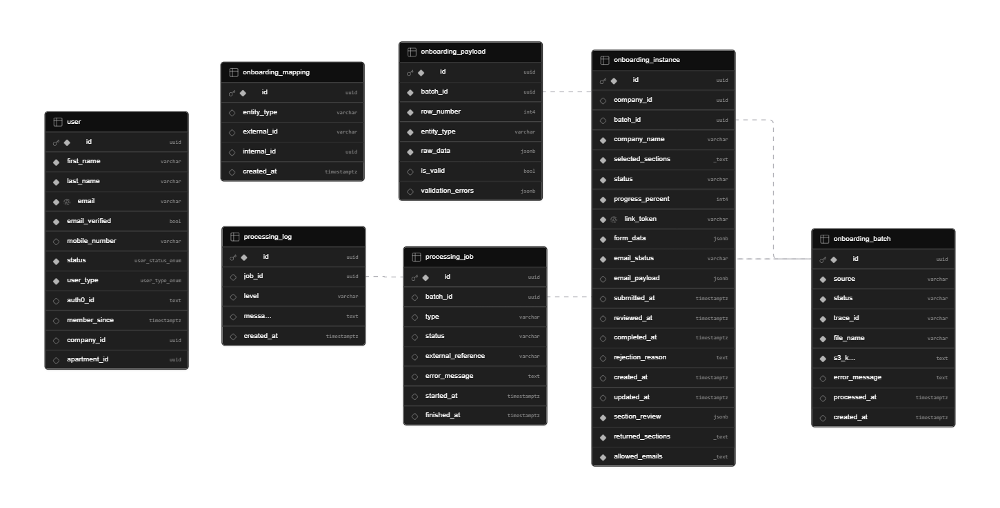

# Data Dictionary - Equiem Database

Version: 2.0  
Schema: equiem  
Database: PostgreSQL 13+  

---

## 📑 Table of Contents

- [Executive Summary](#executive-summary)
- [1. Scope](#1-scope)
- [2. Enums](#2-enums)
	- [user_status_enum](#user_status_enum)
	- [user_type_enum](#user_type_enum)
- [3. Core Tables](#3-core-tables)
	- [user](#user)
- [4. Onboarding and Processing Tables](#4-onboarding-and-processing-tables)
	- [onboarding_batch](#onboarding_batch)
	- [onboarding_payload](#onboarding_payload)
	- [onboarding_mapping](#onboarding_mapping)
	- [processing_job](#processing_job)
	- [processing_log](#processing_log)
	- [onboarding_instance](#onboarding_instance)
- [5. Indexes](#5-indexes)
- [6. Execution Order](#6-execution-order)
- [7. Supabase Implementation](#7-supabase-implementation)

---

## Executive Summary

This document describes the current Supabase/PostgreSQL schema used by the onboarding flow.

Current model highlights:
- 8 active tables in schema `equiem`
- Focused on company management, user authentication, upload lifecycle, payload persistence, processing tracking, and onboarding instance state

Active tables:
- company
- user
- onboarding_batch
- onboarding_payload
- onboarding_mapping
- processing_job
- processing_log
- onboarding_instance

---

## 1. Scope

This dictionary documents the current physical schema defined in [src/data/database/01_create_database.sql](src/data/database/01_create_database.sql).

Tables covered:
- company
- user
- onboarding_batch
- onboarding_payload
- onboarding_mapping
- processing_job
- processing_log
- onboarding_instance

---

## 2. Enums

### user_status_enum
Values:
- active
- inactive
- pending

### user_type_enum
Values:
- commercial
- residential
- visitor

---

## 3. Core Tables

### company
Purpose: represents client companies that undergo onboarding and own onboarding instances.

| Field | Type | Nullable | Default | Notes |
|---|---|---|---|---|
| id | UUID | no | gen_random_uuid() | Primary key |
| name | VARCHAR(255) | no | - | Unique company name |
| approved_domains | TEXT[] | no | {} | List of authorized email domains for auto-approval |
| created_at | TIMESTAMPTZ | yes | NOW() | Creation timestamp |
| updated_at | TIMESTAMPTZ | yes | NOW() | Last update timestamp |

Constraints:
- PRIMARY KEY (id)
- UNIQUE (name)

### user
Purpose: authenticated users linked to onboarding workflows.

| Field | Type | Nullable | Default | Notes |
|---|---|---|---|---|
| id | UUID | no | - | Primary key |
| first_name | VARCHAR(100) | no | - | Given name |
| last_name | VARCHAR(100) | no | - | Family name |
| email | VARCHAR(255) | no | - | Unique email |
| email_verified | BOOLEAN | no | - | Auth/email verification flag |
| mobile_number | VARCHAR(30) | yes | NULL | Optional phone |
| status | user_status_enum | no | - | active/inactive/pending |
| user_type | user_type_enum | no | - | commercial/residential/visitor |
| auth0_id | TEXT | yes | NULL | External identity id |
| member_since | TIMESTAMPTZ | yes | NULL | Optional join date |
| company_id | UUID | yes | NULL | FK to company |

Constraints:
- PRIMARY KEY (id)
- UNIQUE (email)
- FOREIGN KEY (company_id) REFERENCES company(id) ON DELETE SET NULL

---

## 4. Onboarding and Processing Tables

### onboarding_batch
Purpose: one uploaded onboarding file/input lifecycle.

| Field | Type | Nullable | Default | Notes |
|---|---|---|---|---|
| id | UUID | no | gen_random_uuid() | Primary key |
| source | VARCHAR(50) | no | - | Input origin (api, etc.) |
| status | VARCHAR(50) | no | - | Batch lifecycle status |
| trace_id | VARCHAR(120) | no | - | Correlation id |
| file_name | VARCHAR(255) | no | - | Original file name |
| s3_key | TEXT | no | - | Object storage key |
| error_message | TEXT | yes | NULL | Failure details |
| processed_at | TIMESTAMPTZ | yes | NULL | Completion/terminal timestamp |
| created_at | TIMESTAMPTZ | yes | NOW() | Creation timestamp |

Constraints:
- PRIMARY KEY (id)
- CHECK chk_onboarding_batch_status: status IN ('pending','queued','processing','finalizing','completed','failed','invalid')

### onboarding_payload
Purpose: normalized per-row payload items from a batch.

| Field | Type | Nullable | Default | Notes |
|---|---|---|---|---|
| id | UUID | no | gen_random_uuid() | Primary key |
| batch_id | UUID | no | - | FK to onboarding_batch |
| row_number | INT | no | - | Original row position |
| entity_type | VARCHAR(50) | no | - | Domain entity hint |
| raw_data | JSONB | no | - | Original/normalized row JSON |
| is_valid | BOOLEAN | yes | TRUE | Validation result |
| validation_errors | JSONB | yes | [] | Validation errors list |

Constraints:
- PRIMARY KEY (id)
- UNIQUE (batch_id, row_number)
- FOREIGN KEY (batch_id) REFERENCES onboarding_batch(id) ON DELETE CASCADE

### onboarding_mapping
Purpose: maps external ids to internal ids after ingestion.

| Field | Type | Nullable | Default | Notes |
|---|---|---|---|---|
| id | UUID | no | gen_random_uuid() | Primary key |
| entity_type | VARCHAR(50) | yes | NULL | Mapped entity type |
| external_id | VARCHAR(100) | yes | NULL | Source id |
| internal_id | UUID | yes | NULL | Destination id |
| created_at | TIMESTAMPTZ | yes | NOW() | Creation timestamp |

Constraints:
- PRIMARY KEY (id)

### processing_job
Purpose: async processing unit for a batch.

| Field | Type | Nullable | Default | Notes |
|---|---|---|---|---|
| id | UUID | no | gen_random_uuid() | Primary key |
| batch_id | UUID | yes | NULL | FK to onboarding_batch |
| type | VARCHAR(50) | yes | NULL | Job type |
| status | VARCHAR(50) | yes | NULL | Job status |
| external_reference | VARCHAR(255) | yes | NULL | Correlation with external processors |
| error_message | TEXT | yes | NULL | Error description |
| started_at | TIMESTAMPTZ | yes | NULL | Start timestamp |
| finished_at | TIMESTAMPTZ | yes | NULL | End timestamp |

Constraints:
- PRIMARY KEY (id)
- FOREIGN KEY (batch_id) REFERENCES onboarding_batch(id) ON DELETE CASCADE
- CHECK chk_processing_job_status: status IN ('queued','processing','completed','failed','invalid')

### processing_log
Purpose: log lines generated by processing jobs.

| Field | Type | Nullable | Default | Notes |
|---|---|---|---|---|
| id | UUID | no | gen_random_uuid() | Primary key |
| job_id | UUID | yes | NULL | FK to processing_job |
| level | VARCHAR(20) | yes | info | Log level |
| message | TEXT | yes | NULL | Log message |
| created_at | TIMESTAMPTZ | yes | NOW() | Creation timestamp |

Constraints:
- PRIMARY KEY (id)
- FOREIGN KEY (job_id) REFERENCES processing_job(id) ON DELETE CASCADE

### onboarding_instance
Purpose: collaborative onboarding form state and review lifecycle.

| Field | Type | Nullable | Default | Notes |
|---|---|---|---|---|
| id | UUID | no | gen_random_uuid() | Primary key |
| batch_id | UUID | yes | NULL | FK to onboarding_batch |
| company_id | UUID | yes | NULL | FK to company |
| company_name | VARCHAR(255) | no | - | Display company name |
| selected_sections | TEXT[] | no | {} | Enabled sections |
| allowed_emails | TEXT[] | no | {} | Invite/access allowlist |
| status | VARCHAR(50) | no | draft | Onboarding status |
| progress_percent | INT | no | 0 | Completion progress |
| link_token | VARCHAR(120) | no | - | Unique access token |
| form_data | JSONB | no | {} | Saved form payload |
| email_status | VARCHAR(50) | no | pending_manual_send | Invite/submission email state |
| email_payload | JSONB | yes | NULL | Email metadata |
| submitted_at | TIMESTAMPTZ | yes | NULL | Submission timestamp |
| reviewed_at | TIMESTAMPTZ | yes | NULL | Review timestamp |
| completed_at | TIMESTAMPTZ | yes | NULL | Completion timestamp |
| section_review | JSONB | no | {} | Section-level decisions |
| returned_sections | TEXT[] | no | {} | Returned/rework sections |
| rejection_reason | TEXT | yes | NULL | Final rejection reason |
| created_at | TIMESTAMPTZ | yes | NOW() | Creation timestamp |
| updated_at | TIMESTAMPTZ | yes | NOW() | Last update |

Constraints:
- PRIMARY KEY (id)
- UNIQUE (link_token)
- FOREIGN KEY (batch_id) REFERENCES onboarding_batch(id) ON DELETE SET NULL
- CHECK chk_onboarding_instance_status: status IN ('draft','in_progress','equiem_review','completed','rejected')

---

## 5. Indexes

Indexes currently created by schema:

- idx_onboarding_batch_trace_id on onboarding_batch(trace_id)
- idx_onboarding_instance_batch_id on onboarding_instance(batch_id)
- idx_onboarding_batch_status on onboarding_batch(status)
- idx_onboarding_batch_created_at on onboarding_batch(created_at DESC)
- idx_onboarding_payload_batch_id on onboarding_payload(batch_id)
- idx_onboarding_payload_entity_type on onboarding_payload(entity_type)
- idx_onboarding_payload_is_valid on onboarding_payload(batch_id, is_valid)
- idx_onboarding_mapping_entity_external on onboarding_mapping(entity_type, external_id)
- idx_onboarding_mapping_internal_id on onboarding_mapping(internal_id)
- idx_processing_job_batch_id on processing_job(batch_id)
- idx_processing_job_status on processing_job(status)
- idx_onboarding_instance_link_token on onboarding_instance(link_token)
- idx_onboarding_instance_status on onboarding_instance(status)
- idx_onboarding_instance_emails on onboarding_instance(allowed_emails)
- idx_onboarding_instance_status_submitted on onboarding_instance(status, submitted_at DESC)
- idx_onboarding_instance_returned_sections on onboarding_instance USING GIN(returned_sections)

---

## 6. Execution Order

Recommended SQL execution order:

1. [src/data/database/01_create_database.sql](src/data/database/01_create_database.sql)
2. [src/data/database/02_initial_data.sql](src/data/database/02_initial_data.sql)

---

## 7. Supabase Implementation

FIGURE 1 - Supabase Tables (equiem schema) 
	 
	Source: Material produced by the authors, 2026.

---
